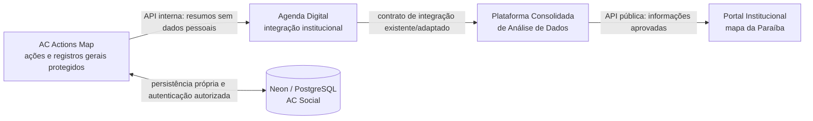

# AC Actions Map — AC Social

> **Precedência em 30/10/2026:** `AGENTS.md`, `PROMPT_INICIAL_SOL.md` e o adendo
> do plano v2.1 substituem as fronteiras conflitantes deste documento histórico.
> O destino vigente inclui domínio ocular próprio; o código atual ainda é geral.
> Login local avançado e assinatura eletrônica estão em standby.
> [Descoberta atual e conflitos](FASE_0_DESCOBERTA_2026-10-30.md).

**Documento de referência para o agente de desenvolvimento**  
**Versão:** 1.0 — 26/10/2026  
**Status:** especificação funcional/técnica proposta; conferir o repositório, os anexos e o banco real antes de implementar consultas, migrações e integrações.  
**Destino:** `docs/AC_ACTIONS_MAP_DOCUMENTACAO_AGENT.md`

> **Decisão posterior — 28/10/2026:** o responsável solicitou todos os dados gerais do PDF, exceto graus/dados oculares, consulta/edição completas, impressão de segunda via e remoção total da página do mapa. Autorizou também completar os cadastros existentes no banco. Essa decisão prevalece sobre o cadastro mínimo e a página de mapa descritos em entregas anteriores. CPF, telefone, datas e responsável ficam privados/cifrados, sem associação clínica ou exposição em integrações. [Especificação implementada, validações e resultado do lote](CADASTRO_BENEFICIARIOS_E_SEGUNDA_VIA.md); [auditoria atual](AUDITORIA_APLICACAO_E_PRINCIPIOS.md). As propostas abaixo permanecem referência histórica quando divergirem desse escopo.

> **Instrução prioritária ao agente:** esta aplicação é o **AC Actions Map — AC Social**, dedicada à **gestão de ações institucionais e ao registro geral de seus participantes/beneficiários**, incluindo importação histórica de PDFs. **Não construir tracking de prontuários, consultas, atendimentos clínicos ou jornada integrada** de Psicologia, Nutrição, ABA ou outros setores. Reutilizar apenas a autenticação institucional dos **profissionais** e os padrões técnicos autorizados do ecossistema. Não assumir que o esquema físico, os endpoints ou os arquivos citados abaixo já foram inspecionados.

> **Decisão posterior do responsável — 26/10/2026:** remover a página redundante de Indicadores e concentrar suas métricas em Visão geral; substituir Dados iniciais por **Importar dados**, com inserção por arquivos. Esta decisão prevalece sobre os nomes e rotas propostos abaixo. A implementação e os limites atuais estão em [Importação por arquivos](IMPORTACAO_ARQUIVOS.md); os demais princípios, inclusive revisão nominal, autorização de produção e separação de dados clínicos, permanecem aplicáveis.

> **Atualização de publicação:** o responsável também removeu o estado de rascunho. Ações novas/editadas vão diretamente para revisão, seguindo para validação e publicação. A API para a Agenda inclui pessoas contempladas, quantidade de ações e municípios. [Fluxo e contrato atuais](PUBLICACAO_E_FLUXO_DE_ACOES.md) prevalecem sobre referências históricas divergentes abaixo.

## 1. Objetivo e fronteiras do projeto

Criar o sistema interno que substitui a **administração das ações hoje vinculadas ao mapa da Paraíba no Portal Institucional**. A equipe autorizada poderá cadastrar, listar, editar, excluir logicamente/arquivar e acompanhar ações realizadas em **um ou vários municípios/locais**; registrar dados gerais das pessoas beneficiadas; importar registros iniciais de formulários PDF digitalizados; e disponibilizar resumos e indicadores gerais à integração institucional.

**Não confundir este projeto com:** Social Framework, ABA Framework, Agenda Digital como sistema de atendimentos ou plataformas de prontuário. O AC Actions Map **não acompanha a trajetória assistencial**, não importa fichas clínicas de outros módulos e não cria vínculos automáticos com o histórico de atendimentos da casa. A identidade **do funcionário que faz login** é centralizada; o cadastro operacional de **beneficiários das ações** é próprio do módulo e deve ser definido a partir dos PDFs e da finalidade de gestão de ações. Não pressupor o uso do `usuario_id` institucional de pacientes nem correlacionar informações entre módulos.

**Fonte de verdade dos requisitos específicos:** esta especificação + anexos reais do projeto. Reutilizar princípios gerais e componentes dos outros documentos AC Social somente se não contradisserem as decisões específicas do AC Actions Map.

## 2. Leitura obrigatória de arquivos e verificação inicial

Antes de construir formulários ou tabelas, o agente deverá:

1. **Ler todos os arquivos de referência em `docs/`**, especialmente os PDFs escaneados do programa inicial, mencionados como **“Melhor Visão”** (confirmar o nome oficial lendo o arquivo). Não presumir nomes de PDFs ou quantidade de registros.
2. Examinar as **duas capturas de tela em `docs/reference/`** (ou no caminho real encontrado) e o **Branding Guide da AC Social**; replicar os padrões efetivamente especificados para login, sidebar, tipografia, cores, espaçamentos, tabelas e modais. Não inventar paleta ou logotipo se o guia não estiver acessível.
3. Examinar documentação e código já existentes do **Portal Institucional**, particularmente CRUD/mapa de ações, estrutura de dados e endpoint que atualmente alimenta o mapa. Conferir que campos são internos e quais são públicos.
4. Examinar o **schema real do PostgreSQL/Neon**, a autenticação e a classificação de profissionais da Agenda Digital: tabela de profissionais, campo de *tipo de login*, vínculo com *equipe*, status ativo, IDs, validação de senha e sessões.
5. Conferir `.env`, `.env.local`, `backend/.env`, secret manager e/ou equivalentes **no ambiente onde o agente está autorizado a trabalhar**, descobrindo as variáveis já configuradas e seus nomes reais. **Não imprimir nem reproduzir valores, chaves ou strings de conexão** em respostas, logs, screenshots, commits ou documentos.
6. Examinar os documentos técnicos já existentes do ecossistema e anotar convenções que devem ser preservadas: Clean Architecture, Clean Code, TypeScript estrito, componentes reutilizáveis, controle de acesso server-side, API versionada, observabilidade, acessibilidade e privacidade desde o desenho.
7. Elaborar um **inventário de campos e mapeamento de origens** antes de definir migrações: coluna do PDF/mapa legado → entidade/campo do sistema → necessidade de coleta → visibilidade → validação → política de retenção.

**Importante:** os PDFs, screenshots, Branding Guide e `.env` são arquivos do repositório/ambiente do desenvolvedor referidos pelo responsável; **não foram disponibilizados para leitura nesta elaboração**. A inspeção acima não deve ser marcada como concluída sem acesso real aos arquivos. PDFs com dados pessoais não devem ser versionados em repositório público; usar armazenamento privado, permissões adequadas e regras de `.gitignore`, sem apagá-los inadvertidamente.

## 3. Login institucional e autorização por tipo + equipe

### 3.1 Regra de entrada

**Não adicionar campo de escolha de equipe nem de tipo de login à tela de login.** O profissional informa exclusivamente suas credenciais institucionais usuais. A aplicação reutiliza a verificação de credenciais da AC Social e, após autenticar, recupera **tipo de login** e **equipe** da fonte institucional existente.

**Política inicial a compatibilizar com os valores reais do banco:**

```text
credenciais_validas
AND profissional_ativo
AND tipo_login == ADMINISTRATIVO
AND equipe IN {ADMINISTRACAO, TECNOLOGIA}
```

Essa interpretação preserva o padrão de acesso administrativo do Portal Institucional e contempla as ferramentas exclusivas de Tecnologia. Confirmar com o cadastro real o significado exato de tipo administrativo, status de conta, equipes e possíveis combinações antes de ativar produção. **Ser da equipe Tecnologia, isoladamente, não basta se o tipo de login não for administrativo.**

### 3.2 Fluxo técnico correto

1. **`POST /api/v1/auth/login`** (sugestão de contrato): recebe login e senha por HTTPS; *nunca usar GET para transmitir credenciais*.
2. Backend valida as credenciais **pelo método que já existe na Agenda Digital**, respeitando hash, sessões e tabela reais. **Não duplicar tabela de senhas.**
3. Backend consulta o tipo de login, vínculo com equipe e status ativo. Só cria/continua sessão caso as condições de acesso sejam atendidas.
4. **`GET /api/v1/auth/me`** retorna ao frontend apenas dados necessários da sessão, por exemplo `profissional_id`, nome de exibição, `tipo_login`, `equipe` e permissões derivadas, **sem senha, segredo nem dados de outras pessoas**.
5. Next.js constrói a sidebar e os botões conforme o papel retornado. O FastAPI **revalida a política em todas as rotas**, inclusive acessos diretos, sem depender da ocultação visual.
6. Mudança de equipe, desativação ou revogação deve encerrar/bloquear acessos subsequentes conforme a estratégia institucional. Sessão segura com cookie HttpOnly/Secure, proteção CSRF quando aplicável, rate limiting e auditoria de login.

### 3.3 Matriz de autorização

| Operação | Administrativo / Administração | Administrativo / Tecnologia | Outros |
|---|:---:|:---:|:---:|
| Entrar no AC Actions Map | Sim | Sim | Não |
| Listar, cadastrar e editar ações | Sim | Sim | Não |
| Registrar dados gerais de beneficiários | Sim | Sim | Não |
| Executar importação inicial aprovada | Sim* | Sim* | Não |
| Excluir/arquivar ação | Sim* | Sim* | Não |
| Visualizar indicadores internos | Sim | Sim | Não |
| Abrir página `/tecnologia/conexao` | **Não** | **Sim** | Não |
| Ver status técnico de API, banco, integrações e tokens | **Não** | **Sim** | Não |
| Administrar/rotacionar credenciais de integração | **Não** | **Sim**, com autorização reforçada | Não |

`*` Confirmar regras de aprovação/dupla checagem e auditoria institucional para ações críticas. Nenhuma permissão administrativa deste módulo autoriza consultar prontuários de outros sistemas.

## 4. Telas e experiência do usuário

### 4.1 Navegação (rotas propostas)

| Rota | Finalidade | Público |
|---|---|---|
| `/login` | Login institucional; sem seleção de equipe | Não autenticado |
| `/dashboard` | Resumo das ações e indicadores operacionais | Administração + Tecnologia autorizadas |
| `/acoes` | Tabela de ações com busca, filtros e ações por linha | Administração + Tecnologia autorizadas |
| `/acoes/[id]` | Detalhamento, locais, beneficiários da ação e histórico de alterações | Administração + Tecnologia autorizadas |
| `/dados-iniciais` ou modal a partir de `/acoes` | Assistente de importação/revisão dos PDFs históricos | Perfis autorizados |
| `/indicadores` | Totalizações operacionais, por período e local | Administração + Tecnologia autorizadas |
| `/tecnologia/conexao` | Diagnóstico de PostgreSQL, API FastAPI, integração com Agenda e tokens | **Somente Tecnologia** |

Adicionar sidebar com atalho para a **Agenda Digital**, sem compartilhar automaticamente permissões. Todos os componentes responsivos, com loading, estados vazios, erros claros, foco de teclado, labels e acessibilidade.

### 4.2 Página **Ações**

- Exibir **todas as ações acessíveis ao usuário** em uma **tabela paginada**, com colunas iniciais: **nome**, **datas**, **locais/municípios** (resumo de N locais), **quantidade geral de beneficiários**, **status** e **ações**.
- Busca por nome; filtros por município, período, categoria e status, conforme campos realmente existentes.
- Botão principal **Cadastrar nova ação**. Cada linha permite **Visualizar**, **Editar** e **Excluir** (implementar, preferencialmente, *soft delete* / arquivamento auditável, com confirmação explícita e atualização dos indicadores).
- Usuário sem registros vê mensagem de estado vazio e botão de criação, em vez de uma tabela sem conteúdo.
- Após mutação, atualizar consultas via React Query; nunca deixar a interface apresentar uma exclusão como concluída antes de confirmação do backend.

### 4.3 Modal **Cadastrar nova ação**

O botão abre **modal acessível** (em celular, diálogo em tela cheia se necessário) com, no mínimo:

1. **Nome da ação** — obrigatório.
2. **Data/período e categoria/descrição** — validar com os campos do mapa legado e documentos reais; não inventar obrigatoriedade.
3. **Locais de realização** — **seleção de N locais** na Paraíba; adicionar/remover localidades no modal sem perder os anteriores. Para cada local, selecionar **município validado pelo código IBGE** e, opcionalmente, informar nome do local/endereço institucional aproximado. Uma ação pode ter **vários locais no mesmo município** e **vários municípios**.
4. **Revisão e salvamento** — validar no frontend e backend, impedir registros de local duplicados acidentais, mostrar erros específicos e confirmar conclusão.

**Referência oficial:** [API de Localidades do IBGE](https://servicodados.ibge.gov.br/api/docs/localidades); a UF Paraíba tem código **25**, portanto a consulta base sugerida de municípios é `GET https://servicodados.ibge.gov.br/api/v1/localidades/estados/25/municipios`. Guardar **código IBGE**, não apenas nome textual, e testar cache/fallback para indisponibilidade da API. Não confundir **município onde a ação ocorreu** com **município de residência informado no formulário do beneficiário**.

## 5. Botão **Cadastrar dados iniciais** e importação dos PDFs

A aplicação terá uma ação visível aos perfis autorizados para **Cadastrar dados iniciais**. Sua finalidade é importar e revisar as pessoas e os vínculos com ações históricas, baseando-se nos **PDFs escaneados disponíveis em `docs/`**, incluindo os documentos do programa inicial, cujo nome deve ser confirmado a partir dos anexos.

### 5.1 Procedimento obrigatório do agente

1. Encontrar e ler cada PDF real; se for um PDF de imagens, inspecionar visualmente as páginas. Empregar extração/OCR apenas quando necessário e **nunca confiar cegamente em reconhecimento automático** de nomes, localidades e outros campos pessoais.
2. Identificar **campos gerais reutilizáveis** em ações de saúde visual, educação, doações, mobilização comunitária etc. **Descartar do modelo genérico as informações específicas de óptica** (grau de lentes, receituário, dioptrias, medidas oftálmicas e semelhantes); não transplantar um prontuário da ação Melhor Visão para todo o sistema.
3. Sugerir um **dicionário mínimo de dados** baseado no que realmente consta dos formulários. Exemplos de categorias a validar: identificação geral da pessoa, município informado, referência da ação, data de participação e observações estritamente operacionais. **Não presumir CPF, contato, data de nascimento ou qualquer campo como obrigatório sem justificar finalidade e conferir o documento.**
4. Produzir prévia de importação com **origem (arquivo/página), valores extraídos, campos duvidosos e avisos de duplicidade**, em área restrita. Revisar manualmente antes de gravar, sobretudo nomes próprios.
5. Validar município informado no PDF versus municípios IBGE. Distinguir localização da pessoa de localização da ação. Para informação ausente/ilegível, marcar **“não identificado / revisar”**, nunca inventar preenchimentos.
6. Executar importação transacional, em lotes controlados e **idempotentes**, inicialmente em staging. Usar hash do arquivo, identificador da linha/origem e chaves de negócio seguras para prevenir reimportações. Relatar inclusões, associações existentes, duplicidades, falhas e pendências.
7. Exigir **confirmação administrativa expressa para importar na base de produção** e preservar backup/rollback. Não inserir dados pessoais de produção em ambiente de testes sem proteção/anonimização adequada.

### 5.2 Comportamento do botão no produto

Proposta de assistente em quatro etapas no modal/tela: **(1) selecionar documento já autorizado ou fazer upload protegido → (2) conferir campos e visualização de registros → (3) revisar correspondências, duplicidades e ação de destino → (4) confirmar importação e visualizar relatório**. Uploads passam por checagem de extensão, MIME real, tamanho e permissões, e são guardados apenas em storage privado com retenção definida. Não colocar PDFs escaneados em `/public` nem enviar dados pessoais a serviços externos de IA/OCR sem avaliação jurídica e técnica específica.

## 6. Modelo de dados proposto (a confirmar contra o schema real)

**Não aplicar migrações antes de inspecionar o schema existente e o mapa legado.** O projeto usa o **mesmo PostgreSQL/Neon institucional**, mas precisa de **tabelas próprias e privilégios de banco restritos**. Nomes ilustrativos:

| Tabela sugerida | Campos essenciais sugeridos | Observações |
|---|---|---|
| `acoes_map_acoes` | `id`, `nome`, `categoria`, `descricao`, `inicio_em`, `fim_em`, `status`, `criado_por_profissional_id`, `criado_em`, `atualizado_em`, `excluido_em` | Metadados da ação. Ref. ao profissional institucional, sem replicar credenciais. |
| `acoes_map_locais` | `id`, `municipio_ibge`, `nome_local`, `referencia_publica_aproximada` | Localizações; evitar endereço residencial privado. |
| `acoes_map_acao_local` | `acao_id`, `local_id` | Relação **N:N**: ação com vários locais e eventual reutilização de local por mais de uma ação. |
| `acoes_map_beneficiarios` | `id`, `nome` e **somente campos gerais justificados pelo PDF**, `municipio_residencia_ibge` opcional, `criado_em` | Cadastro **específico para ações**. Não trazer prontuário, diagnóstico ou tracking de atendimento; não presumir vínculo com usuário clínico. |
| `acoes_map_participacoes` | `id`, `acao_id`, `beneficiario_id`, `data_evento` (se aplicável), `local_id` (se conhecido), `origem_registro` | Vínculos gerais entre beneficiário e ação. Impedir duplicata no **mesmo contexto** sem impedir participação em outras ações. |
| `acoes_map_importacoes` | `id`, `hash_arquivo`, `identificador_origem`, `status`, `resumo_resultados`, `autor_id`, `data_importacao` | Provar origem, permitir conferência e reprocessamento sem duplicar. Evitar conteúdo pessoal nos logs. |
| `acoes_map_integracoes_outbox` | `id`, `tipo_evento`, `versao`, `idempotency_key`, `payload_sem_dados_pessoais`, `status`, `tentativas` | Integração confiável com Agenda Digital. |
| `acoes_map_auditoria` | `id`, `profissional_id`, `operacao`, `entidade`, `entidade_id`, `data_hora`, `metadata_nao_sensivel` | Auditoria de CRUD, imports, leitura sensível e rotação de credenciais. |

Caso não seja necessário reutilizar locais, pode-se implementar `acoes_map_locais` com FK `acao_id` direta (**1:N**). Escolher após analisar o mapa legado, mas **a regra imprescindível é: N locais por ação**. Preferir UUIDs internos, índices em chaves e datas, FKs reais e soft delete auditável. Evitar exclusão em cascata dos beneficiários quando uma ação é arquivada.

## 7. API e integração com Agenda Digital

**Fluxo institucional mantido para indicadores, não para acompanhamento pessoal:**



**Sugestões de endpoints privados, sujeitos a verificação de padrões existentes:**

```text
POST   /api/v1/auth/login
GET    /api/v1/auth/me
POST   /api/v1/auth/logout
GET    /api/v1/acoes
POST   /api/v1/acoes
GET    /api/v1/acoes/{id}
PATCH  /api/v1/acoes/{id}
DELETE /api/v1/acoes/{id}            # exclusão lógica/arquivamento, conforme contrato
GET    /api/v1/localidades/pb       # proxy/cache opcional do IBGE
POST   /api/v1/importacoes/preview  # acesso e payload protegidos
POST   /api/v1/importacoes/confirmar
GET    /api/v1/importacoes/{id}/status
GET    /api/v1/indicadores
GET    /api/v1/tecnologia/saude     # somente Tecnologia
POST   /api/v1/tecnologia/tokens/rotacionar # somente Tecnologia + proteção extra
```

A integração **AC Actions Map → Agenda Digital** transportará **resumos de ações**: identificador técnico da ação quando necessário, categorias, período, código IBGE de municípios, totais gerais e status de publicação. **Não transportar lista de beneficiários, nome, CPF, contatos, IDs individuais ou campos privados.** Usar autenticação serviço-a-serviço, contrato OpenAPI/Pydantic versionado, outbox, retries com backoff, deduplicação/idempotência e auditoria de entrega. A Agenda Digital não vira banco paralelo de beneficiários do AC Actions Map.

**Atenção a múltiplos locais:** definir se a métrica é **ações distintas** ou **ocorrências por local**. Uma ação em 3 cidades deve contar **1 ação no total global**, mas pode aparecer em **3 recortes municipais**; a soma municipal **não** deve ser apresentada como total global sem deduplicação. Contagens de beneficiários não devem ser repetidas entre municípios por suposição.

O **Portal Institucional** permanece o responsável pela **visualização pública** do mapa; a edição deve migrar para o AC Actions Map, com backup, staging, comparação de indicadores, virada controlada e rollback. O portal só recebe campos públicos revisados.

## 8. Página exclusiva **Tecnologia → Conexão**

Criar página restrita a profissional com `tipo_login=administrativo` **e** equipe Tecnologia, também com checagem no FastAPI:

- **Banco de dados:** status de conectividade (ex.: OK/indisponível), latência aproximada e último check; a verificação deve fazer consulta leve e permitida, sem retornar host completo, usuário, string de conexão, nomes de dados sensíveis ou segredos.
- **API FastAPI:** healthcheck, versão/deploy (quando não sensível), latência e últimas falhas sanitizadas.
- **Agenda Digital:** conectividade, status da última sincronização, horário da última confirmação, fila pendente, tentativas e erros seguros.
- **Credenciais/tokens de serviço:** mostrar apenas **alias, escopo, status, validade/rotação e sufixo mascarado**. Permitir provisionar/rotacionar/revogar via backend/secret manager com autorização adicional e auditoria; **nunca ler ou exibir token armazenado em texto claro**. Ao criar novo token, se o mecanismo exigir visualização única, mostrar uma vez de forma controlada e não persisti-lo no frontend.
- Informar **“sem permissão”** ao acesso indevido, inclusive por URL direta ou cliente HTTP.

### 8.1 Checagem segura de variáveis de ambiente (`.env`)

O agente deve detectar **nomes e locais reais** das variáveis do projeto antes de criar novas. Como referência **não obrigatória**, configurações típicas seriam `DATABASE_URL`, `AGENDA_API_BASE_URL`, `AGENDA_SERVICE_TOKEN`, `SESSION_SECRET` e `APP_ENV`. **Não substituir nomes já padronizados sem necessidade**.

**Ordem de validação:**

1. Verificar existência das **chaves esperadas** e se os valores foram provisionados, **sem imprimir o conteúdo**.
2. Confirmar segregação **desenvolvimento / staging / produção** e existência de `.env.example` contendo **somente placeholders**. Garantir `.env*` sensíveis no `.gitignore` conforme necessidade, com exceção de um `.env.example` seguro.
3. Colocar `DATABASE_URL`, tokens e demais segredos **somente no backend/secret manager**, nunca com prefixo `NEXT_PUBLIC_` no Next.js, nunca em bundle ou logs.
4. Testar conexão do PostgreSQL com permissão mínima e consulta neutra (`SELECT 1`), além de timeout/SSL conforme configuração efetiva da Neon.
5. Validar o healthcheck da API e depois a integração com Agenda em **staging**, com credenciais específicas, sem fazer alteração destrutiva.
6. Reportar apenas resultados sanitizados: `CONFIG_OK`, `CONFIG_AUSENTE`, `DB_OK`, `DB_ERRO`, `API_OK`, `AGENDA_OK`, horário e latência quando úteis; **não divulgar DSN, token, senha, usuário do banco ou traceback com secrets**.
7. Se variável essencial estiver ausente ou conexão não funcionar, registrar a pendência; **não inventar credenciais nem tentar acessar produção sem autorização**.

## 9. Stack, arquitetura e padrões obrigatórios

| Área | Padrão |
|---|---|
| Frontend | Next.js App Router + React + TypeScript estrito + Tailwind CSS |
| Componentes | Material UI (MUI), React Icons, React Hot Toast, tema do Branding Guide |
| Requisições | Axios + TanStack React Query, cache e invalidação após escrita |
| Formulários | React Hook Form + Zod; validação também no FastAPI |
| Backend | Python + FastAPI + Pydantic |
| Banco | PostgreSQL/Neon institucional, tabelas isoladas do módulo |
| Persistência/migrações | SQLAlchemy + Alembic, depois de mapear schemas e constraints reais |
| Observabilidade | Logs sanitizados, auditoria, healthchecks e status das integrações |
| Qualidade | pytest, testes de integração, Playwright, ESLint, checagem TypeScript |
| Arquitetura | Clean Architecture, Clean Code, separação domínio/aplicação/infra/presentation, reutilização sem acoplamento indevido |
| UX | Mobile-first, acessibilidade WCAG 2.2 AA como objetivo, componentes consistentes, contraste, foco e teclado |

Não instalar React Router para navegação padrão de Next.js. Não adicionar Pandas/NumPy sem necessidade concreta. Usar staging, migrações revisáveis, backup e rollback. Não criar novos microserviços apenas por conveniência. Não assumir o deploy do FastAPI na Vercel sem verificar a infraestrutura real.

## 10. LGPD e privacidade: requisitos de lançamento

1. **Finalidade e minimização:** coletar somente dados gerais indispensáveis à gestão das ações. Documentar justificativa de cada campo com a instituição; excluir campos ópticos e de prontuário do modelo genérico.
2. **Base legal e transparência:** a instituição deve determinar e documentar a base legal adequada para cada finalidade, não presumindo consentimento como solução universal. Estabelecer política de aviso e atendimento a direitos dos titulares.
3. **Segregação:** PDFs de pessoas e dados de beneficiários são privados. O fluxo público contém apenas agregados e informações publicáveis; nenhuma lista nominal de participantes.
4. **Permissões reais:** autenticação, autorização no backend e auditoria; revogação ao mudar equipe/status, mínimo privilégio e controle de acesso ao storage privado.
5. **Segurança:** HTTPS/TLS, criptografia em repouso quando disponibilizada, proteção contra exposição em logs e frontend, limites de requisição, consultas parametrizadas, gestão segura de segredos, backups e recuperação testados.
6. **Retenção e descarte:** definir prazos proporcionais à finalidade e obrigações institucionais; controlar arquivamento e exclusão. Cópias importadas e dados temporários de extração devem ter política de expiração.
7. **Importação supervisionada:** impedir associação automática por nomes semelhantes. Erros de leitura de PDFs não justificam preenchimento inventado. Revisar com responsável autorizado antes de produção.
8. **Publicação restrita:** resumos públicos e contagens passam por aprovação e avaliação de risco de identificação por pequenos grupos/localidades; quando necessário, suprimir ou agregar valores.
9. **Crianças/adolescentes e dados sensíveis:** aplicar cuidados específicos conforme origem e conteúdo dos arquivos; não presumir autorização de divulgação por constar no PDF.
10. **Auditoria e incidentes:** registrar atos essenciais sem criar logs com PII, definir responsáveis, plano de resposta a incidente e processo de revisão.

Referências oficiais: [LGPD — Lei 13.709/2018](https://www.planalto.gov.br/ccivil_03/_ato2015-2018/2018/lei/l13709.htm); [ANPD — materiais orientativos](https://www.gov.br/anpd/pt-br/centrais-de-conteudo/materiais-educativos-e-publicacoes); [IBGE — API de Localidades](https://servicodados.ibge.gov.br/api/docs/localidades). A decisão jurídico-institucional compete à AC Social.

## 11. Plano de execução para o agente

**Etapa 0 — Descoberta (obrigatória):** conferir os PDFs, duas telas em `docs/reference`, Branding Guide, `.env`/secret manager, schema do banco, autenticação da Agenda e código do mapa no Portal. Entregar inventário de campos, permissões, integração e dúvidas de origem sem expor dados pessoais.

**Etapa 1 — Fundação:** inicializar projeto e camadas front/back padronizadas; integrar a sessão institucional e `GET /auth/me`; construir sidebar responsiva e guards de backend; verificar DB em ambiente autorizado.

**Etapa 2 — Ações e múltiplos locais:** modelar CRUD de ações, associação de N locais IBGE, modais, filtros, edição, exclusão lógica, auditoria e validações.

**Etapa 3 — Dados iniciais:** extrair/revisar PDFs em ambiente controlado, definir dicionário de campos gerais, implementar assistente de importação com preview, duplicidade e idempotência; testar primeiro em staging; aprovação expressa antes de gravação em produção.

**Etapa 4 — Integrações e mapa:** criar API interna agregada para Agenda, outbox e status, adaptar contratos já existentes para Plataforma de Análise/Portal sem transportar PII; planejar migração gradual do CRUD legado.

**Etapa 5 — Área de Tecnologia e homologação:** healthchecks, gestão segura de integrações/tokens, testes 401/403, auditoria, performance, responsividade, acessibilidade, backup e rollback.

**Atenção:** atividades de construção em desenvolvimento não equivalem a autorização para **modificar dados compartilhados ou executar importação/migração em produção**. Toda alteração estrutural e gravação massiva deve ser revisada antes.

## 12. Checklist de aceite

- [ ] Aplicação nomeada **AC Actions Map — AC Social** em documentação e interface.
- [ ] Não há acompanhamento de prontuário, atendimentos de outros setores ou tracking longitudinal.
- [ ] Login reutiliza credenciais institucionais, **sem campos de equipe/tipo no formulário**; tipo de login e equipe são obtidos e validados no backend.
- [ ] Acesso geral: tipo administrativo **e** equipe Administração/Tecnologia; página técnica bloqueada para Administração.
- [ ] Página **Ações** tem tabela, busca, editar, excluir/arquivar e botão de cadastro.
- [ ] **Cadastrar nova ação** abre modal e permite **N locais** dentro da Paraíba, validados por código IBGE.
- [ ] **Cadastrar dados iniciais** importa PDFs escaneados com preview, revisão humana, origem e controle de duplicidade.
- [ ] Campos são gerais; informações ópticas da ação inicial não viram cadastro obrigatório.
- [ ] Tabelas do módulo são próprias e preservam o banco institucional e o cadastro de profissionais.
- [ ] Integração AC Actions Map → Agenda Digital tem status, autenticação, idempotência e envia somente dados gerais/agregados.
- [ ] Página de Tecnologia mostra status DB/API/integrações, mas **não expõe valores secretos** nem dados privados.
- [ ] `.env` e credenciais são verificados sem exibição, versionamento ou compartilhamento de segredos.
- [ ] Branding Guide e duas referências visuais foram **de fato lidos** e aplicados.
- [ ] LGPD, auditoria, backup/rollback, testes e acessibilidade foram validados.
- [ ] Migração do mapa antigo para o novo gerenciador não deixa dois escritores concorrentes.

---

### Pendências que só a inspeção dos arquivos/repositórios pode resolver

- Nome oficial do programa histórico, nomes e quantidades dos PDFs, lista exata de campos dos formulários e qualidade das digitalizações.
- Nome/caminho do Branding Guide e tokens visuais, além das duas screenshots.
- Nomes reais de tabelas/colunas de login, equipes, permissões e dados do mapa atual.
- Contratos de API já existentes entre Agenda Digital, Plataforma Consolidada e Portal.
- Nomes reais das variáveis de ambiente, conectividade atual, permissões do usuário do banco e estratégia de gestão de segredos.
- Critérios institucionais de publicação, retenção, exclusão e validação de importações.

**Regra final ao agente:** prefira inspecionar, documentar e confirmar em vez de adivinhar. Use os padrões já consolidados da AC Social como referência técnica; quando conflitar com outras aplicações, prevalece o **escopo específico do AC Actions Map** descrito aqui.
