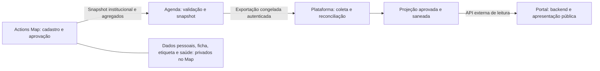

# Novos metadados de ações — APIs e aplicações consumidoras

Data: 30/10/2026. Estado: **documentação para implementação coordenada**.
Base inspecionada do Actions Map: `c5fe90f`. Os caminhos dos outros projetos
abaixo foram lidos no workspace, sem executar suas aplicações ou consultar produção.

## 1. O que precisa ser completado

As informações novas definidas no plano de 30/10 são: nome/título e número da
emenda ou convênio, autor da emenda, órgão governamental, clínica parceira,
logomarcas autorizadas e indicadores por ação/município/instrumento/autor.
São requisitos novos, **não campos já disponíveis no contrato em produção**.
O `Summary` atual do Map e o receptor da Agenda aceitam somente o item **1.1**,
sem esses metadados. O cadastro de origem também precisa ser implementado.

Este documento detalha as dependências entre as quatro aplicações. Não é registro
de implantação, aceite editorial nem autorização para publicar dados. Complementa
a [descoberta da Fase 0](FASE_0_DESCOBERTA_2026-10-30.md) e o
[plano do MVP](PLANO_MVP_E_ACEITE_2026-10-30.md).



Nenhum consumidor busca dados diretamente do banco do Map. O Portal consulta
somente a Plataforma. A API externa hoje é autenticada; preparar conteúdo para
divulgação não significa remover sua autenticação ou expor a credencial no browser.

## 2. Contratos efetivamente encontrados

| Salto | API/contrato atual | O que falta |
| --- | --- | --- |
| Map → Agenda | `POST /api/integracoes/v1/acoes/resumos` na Agenda; item `schema_version="1.1"`, Bearer, Idempotency-Key e ACK 1.1 | Nova versão do item, aprovação dos metadados, validador e ACK compatíveis |
| Agenda → Plataforma | `GET /api/analytics/v2/acoes`, envelope `schema_version="2.0"`, `item_schema_version="1.1"`, exportacao_id, geração, validade, checksum e páginas congeladas | Consumidor de ações na Plataforma e evolução explícita do envelope para os novos itens |
| Consulta antiga da Agenda | `GET /api/analytics/acoes`; continua existindo | Não usar sua paginação como substituta da exportação congelada para promover um conjunto completo |
| Consulta opcional Map → Agenda | Next do Map: `GET /api/integracoes/v1/acoes/resumos`; envelope/itens 1.1, token próprio `acoes.resumos.read` | Atualizar seu contrato/validador se for usado para reconciliar itens novos; não o usar como atalho para Plataforma/Portal |
| Plataforma → Portal | Rota existente da Plataforma `/api/v1/analytics`; Portal reconhece envelope `versao="1"` e bloco `acoesInstitucionais`, `versaoCalculo="1.0"` | O produtor local inspecionado não contém esse bloco; faltam publicação da fonte de ações e projeção dos novos campos |
| Portal → visitante | Backend do Portal: `GET /api/v1/public/acoes`; resposta atual com totais e municípios | Schema/mapper/UI de ações individuais, emenda/autor, logos e rankings aprovados |

Na Agenda, a exportação v2 atual já possui 100 itens por página, até 10.000 ações,
16 MiB por conjunto e validade de 15 minutos. O envelope repete os totais globais
em todas as páginas: não somá-los por página. A lista contém somente snapshots
publicáveis; sua ausência em uma **exportação completa validada** retira
elegibilidade, sem comprovar exclusão física.

O exportador de consulta do Map é outro contrato: até 1.000 ações/2 MiB e cinco
minutos, incluindo revisões e retiradas. Seus limites e canonicalização não são
os da Agenda. Não misturar páginas, IDs, checksums ou tokens desses dois serviços.

Na Plataforma inspecionada, o cliente de fontes externas contempla Agenda de
atendimentos e Acesso Digital. Não foi localizado consumidor da nova fonte de ações
nos diretórios pesquisados. O Portal já tem leitor de agregados municipais; isso
não prova que a Plataforma publique o bloco nem que o pipeline esteja funcionando.

## 3. Matriz dos dados novos

| Informação e origem no Map | Agenda | Plataforma | Portal / regra de divulgação |
| --- | --- | --- | --- |
| ID/versão da ação, período, categoria e municípios IBGE | Preservar identidade e revisão; receber snapshot de substituição | Uma revisão corrente por ação; não somar revisões | ID público de ação somente se aprovado; período ausente continua ausente |
| Nome/título da ação e resumo público | Receber somente a projeção editorial aprovada | Validar/sanear textos; manter aprovação vinculada à revisão | Cards/lista/detalhes da ação; nunca usar descrição interna como fallback |
| Nome/título da emenda ou convênio | Guardar no snapshot institucional aprovado | Dimensão de filtro/agrupamento com identidade estável | Mostrar quando aprovado; ausência não vira emenda fictícia |
| Número da emenda/convênio | Preservar como texto | Filtrar por identificador textual, sem conversão numérica | Preservar zeros e formatação; não inventar número histórico |
| Autor da emenda | Metadado administrativo aprovado, distinto de paciente | Agrupar por autor identificado, não só grafia do nome | Nome administrativo aprovado; nenhuma relação nominal de beneficiário com autor |
| Tipo do instrumento e apoio TOTAL/PARCIAL | Validar enumerações contratadas; nulo quando desconhecido | Filtros próprios, sem inferir valores financeiros | Divulgação somente aprovada; ambos os tipos de apoio admitem os dois logos opcionais |
| Órgão governamental e clínica parceira | IDs institucionais/nome público e referência de logo autorizada | Dimensões e projeção pública controladas | Mostrar separadamente, sem transformar parceiro ausente em obrigatório |
| AC Social + logos opcionais governo/clínica | Não transportar arquivos privados ou base64 de imagens | Referenciar apenas derivada pública aprovada, com validade/revogação | Marca AC Social oficial; duas posições opcionais, alt text e layout que funcione sem uploads |
| Profissional parceiro, se a função futura for liberada | Só projeção expressamente autorizada | Nome/CRM/UF aprovados; nunca inferir habilitação | Opt-in, sem CPF, contato privado, conta local ou vínculo a caso/paciente; CNES identifica estabelecimento |
| Quantidades de ações, pessoas contempladas por ação e participações | Preservar medidas separadas | Conciliar totais e denominadores; filtros com semântica explícita | Rótulos corretos; não anunciar pessoas únicas entre ações |
| Pessoas únicas por emenda/autor | Exige agregado específico calculado no Map, conforme seção 7 | Validar escopo/geração e usar agregado pronto; não deduplicar pacientes | Ranking somente após aprovação e comprovação do denominador |
| Fichas, etiquetas, reimpressões e entregas | Não receber artefatos ou registros individuais | Não presumir disponibilidade no item 1.2; eventuais contagens operacionais exigem contrato/aprovação próprios | Fora da primeira projeção pública; reimpressão nunca aumenta pessoas/atendimentos |
| Nome/CPF/contato de beneficiário, ID de pessoa/atendimento, ficha, grau, diagnóstico, sangue, assinatura e documento clínico | **Não receber** | **Não receber** | **Nunca publicar** |

Campos administrativos são cadastrados uma vez pela Administração/Tecnologia na
ação. Recepção e documentos internos herdam esses dados; isso não autoriza a
Agenda a coletá-los por paciente. Autorização de uso de logo no impresso é distinta
de autorização para publicar o logo no Portal.

## 4. Evolução recomendada do contrato

### 4.1 Item 1.2 — proposta a aprovar

Manter o item 1.1 congelado. Criar um schema explícito para 1.2, rejeitando extras
inclusive em objetos aninhados. O exemplo abaixo é **sintético e proposto**, não
payload aceito hoje nem schema executável. Os nomes/IDs novos serão congelados
no PR de contrato antes do emissor ser habilitado.

```json
{
  "schema_version": "1.2",
  "event_id": "cc1b4ad4-9f19-493e-8400-28600f75c6a2",
  "source": "ac-actions-map",
  "acao_id": "75d8ea1d-69be-4e62-9c39-18f1d111aac3",
  "revisao": 2,
  "operacao": "upsert",
  "categoria": "Saúde ocular",
  "inicio_em": null,
  "fim_em": null,
  "municipios_ibge": ["2508901"],
  "quantidade_acoes": 1,
  "quantidade_participacoes": 12,
  "quantidade_pessoas_contempladas": 12,
  "publicavel": true,
  "metadados_publicos": {
    "titulo_acao": "Ação de exemplo",
    "resumo_publico": "Resumo institucional aprovado para demonstração.",
    "instrumento": {
      "id": "8d51b449-16af-454c-a3b6-2640cecd32a0",
      "tipo": "EMENDA",
      "nome": "Instrumento de exemplo",
      "numero": "0001/2026",
      "autor": {
        "id": "0dab79f6-b460-419c-9637-e6d4fcdf74df",
        "nome": "Autor de exemplo"
      }
    },
    "apoio": "PARCIAL",
    "orgao_governamental": null,
    "clinica_parceira": null,
    "profissionais_parceiros": []
  }
}
```

Regras para congelar o contrato:

- `metadados_publicos=null` quando não houver projeção aprovada. O bloco e seus
  campos nullable representam **substituição integral**, não patch: `null` retira
  o valor anterior. Não preencher nome, autor, apoio, logo ou data por inferência.
- Proposta de limites alinhados ao cadastro: título/nome 160, resumo 1.000 e
  número do instrumento 80 caracteres; validar números como texto, IDs estáveis,
  enumerações e limites de listas. Confirmar o orçamento do item dentro dos
  32 KiB atualmente aceitos pelo receptor; nenhuma imagem binária no JSON.
- `instrumento.id` e `autor.id` são identidades administrativas propostas, criadas
  na origem; não existem hoje no modelo. Não usar nome ou número isolado como
  identidade universal. Política para instrumento/autor desconhecido deve ser
  aprovada; um convênio pode ter autor não aplicável.
- Órgão/clínica, quando autorizados, terão objeto estrito com ID institucional,
  nome público e `logo_url` nullable. URLs precisam pertencer a origem pública
  aprovada; não aceitar arquivo privado, URL com token, caminho local, SVG ativo,
  HTML, base64 ou URL arbitrária de terceiro.
- Manter o asset privado separado da derivada pública saneada. A aprovação deve
  vincular hash/versão do asset. Revogar uso público precisa retirar referência e
  invalidar acesso/cache da derivada; só remover a imagem da página não revoga
  uma URL pública já conhecida.
- Profissionais parceiros ficam vazios por padrão. Se aprovados, o contrato
  limita a projeção a nome/CRM/UF; os dados da assinatura, CPF e credenciais não
  podem ser reaproveitados para essa finalidade.
- `publicavel=false` ou `archive` não carrega metadados públicos. Retirada de
  metadado pode conservar os totais da ação quando a aprovação dos totais continuar
  válida. A Plataforma precisa distinguir essa retirada de arquivamento da ação.
- Alteração/revogação gera **nova revisão e novo evento**; não editar o payload
  de evento já enviado nem reinterpretar a revisão antiga como contrato 1.2.
  Legado 1.1 continua identificado como “sem suporte aos metadados novos”.
- A chave `acao:{id}:v{revisao}` continua identificando um único conteúdo. Não
  emitir 1.1 e 1.2 com a mesma revisão/chave; a Agenda corretamente retorna 409.
- O ACK deve devolver a versão do **evento recebido**, seu event_id e
  accepted/duplicate. O worker atual compara literalmente 1.1 e precisa mudar.

### 4.2 Envelope da Agenda e projeção da Plataforma

**Não substituir itens 1.1 por 1.2 dentro do envelope 2.0 atual**, que declara
`item_schema_version="1.1"`. Atualizar primeiro leitores, persistência e contratos.
Recomendação para o PR de integração: nova revisão de envelope, candidata **2.1**,
com negociação explícita e suporte a conjuntos de itens legados e novos.

Uma proposta é acrescentar `export_schema_version=2.1` ao GET existente
`/api/analytics/v2/acoes`. **Esse parâmetro não existe hoje e é rejeitado pela rota**.
O contrato final deve fixar a negociação antes da implementação. O envelope novo
deve declarar as versões de itens presentes, preservar cada evento original e
identificar a canonicalização nova; não transformar um evento 1.1 em 1.2 para
completar campos ausentes. Cada exportação congela versão, conjunto e checksum;
páginas seguintes exigem a mesma negociação e exportacao_id.

O modo legado 2.0 só pode responder um conjunto completo compatível. Se houver
snapshot novo incompatível, não omiti-lo, zerar totais ou voltar a snapshot antigo:
responder erro de compatibilidade documentado, sem promover dados. **Antes de
ativar 1.2, migrar todos os consumidores ativos que só leem 1.1/2.0.** A mera
existência de duas rotas não garante compatibilidade de seus dados.

A projeção Plataforma → Portal também precisa de versão nova explícita para
ações detalhadas/rankings. O bloco atual de cálculo 1.0 admite somente agregados
municipais e rejeita campos extras. Congelar schema da projeção e sua forma de
negociação, atualizar o leitor do Portal primeiro e preservar o leitor 1.0 durante
a transição. Não mudar silenciosamente o significado de `versaoCalculo` nem usar
um novo endpoint como se já existisse. A decisão deve constar dos contratos das
duas aplicações antes de publicar os novos campos.

## 5. Trabalho por aplicação

### 5.1 Actions Map — origem e emissor

Arquivos atuais: `backend/app/domain/contracts.py`,
`backend/app/infrastructure/actions.py`, `outbox.py`, `integrations.py`,
`backend/app/domain/integrations.py`, `src/features/actions/` e `docs/contracts/`.

1. Implementar cadastro administrativo dos novos metadados/parceiros e autorização
   de publicação, com campos privados separados da projeção pública. Preservar
   versões de documentos internos já emitidos e suas marcas da época.
2. Construir snapshot 1.2 por allowlist na mesma transação de ação/auditoria/outbox.
   Revisão ou revogação de campo/asset gera evento de substituição/retirada.
3. Atualizar worker e ACK para versões suportadas, sem classificar 1.2 como
   `aguarda_republicacao`. Preservar retries, idempotência e eventos 1.1 pendentes.
4. Atualizar também DTO/exportador de leitura para a Agenda: hoje rejeitam payload
   diferente de 1.1. Definir negociação e atualizar health/BFF/schemas conforme
   o contrato aprovado; não liberar esse acesso a outros consumidores.
5. Gerar schemas/OpenAPI e fixtures sintéticas compartilháveis. Habilitar emissor
   novo só após comprovação dos consumidores; configurar rollback do modo de emissão.

### 5.2 Agenda Digital — receptor e redistribuição

Arquivos atuais sob `../agenda-digital/`:

| Arquivo | Alteração necessária |
| --- | --- |
| `src/modules/actions-map/domain/summary.ts` | União discriminada 1.1/1.2, validação aninhada e limites; preservar a interpretação de 1.1 |
| `src/modules/actions-map/application/routes.ts` | Aceitar versão negociada, ACK com versão recebida e erros sem eco; manter Bearer/Idempotency-Key e limite de corpo |
| `src/modules/actions-map/infrastructure/summaryRepository.ts` | Persistir snapshot completo/versionado e hash; igualdade de evento/revisão com conteúdo divergente continua conflito; revisão antiga não sobrepõe nova |
| `src/modules/actions-map/domain/frozenExport.ts` | Novos tipos, versões de itens e canonicalização; ordenação determinística e contagens coerentes |
| `src/modules/actions-map/application/frozenExportRoute.ts` | Negociação do envelope e parâmetros, congelamento de versão e respostas de incompatibilidade |
| `src/modules/actions-map/infrastructure/frozenExportRepository.ts` | Preservar metadados/versões no conjunto imutável, manifesto, geração, quota e retirada; migração aditiva se o manifesto exigir novas colunas |
| `src/app/api/integracoes/v1/acoes/resumos/route.ts` e `src/app/api/analytics/v2/acoes/route.ts` | Composição dos novos handlers sem alterar as APIs clínicas existentes |

O banco atual guarda payload em JSONB, mas isso **não elimina** a necessidade de
alterar validadores, tipos, hash, serialização, persistência de versão e exportação.
A Agenda não cadastra paciente nem corrige emenda de forma independente da origem.
Não calcular ranking de pessoas únicas a partir da soma das ações recebidas.

A v2 atual calcula checksum sobre `JSON.stringify` dos itens normalizados pelo
parser, campos em ordem definida e ações ordenadas por ID. O Map usa outra
canonicalização. Preservar os hashes antigos e dar identificador próprio à nova
regra; fixtures entre Python/TypeScript devem cobrir acentos, null, ordem das
chaves, municípios e objetos aninhados. Não regravar inbox antiga para trocar hash.

### 5.3 Plataforma Consolidada — coleta, análise e publicação

Arquivos atuais sob `../plataformaconsolidadadedados/`:

- `backend/legacy/infrastructure/apis/cliente-apis-analiticas.ts`: fontes atuais
  são atendimentos da Agenda e Acesso; criar fonte/módulo separado de ações.
- `backend/legacy/application/dashboards/obter-dashboard-interativo.ts` e
  `frontend/src/domain/dashboards/tipos.ts`: preservar indicadores clínicos atuais,
  acrescentando domínio de ações sem misturar pessoas/participações/atendimentos.
- `frontend/src/server/external-api/analytics.ts`,
  `frontend/src/app/api/v1/analytics/route.ts` e
  `contracts/external-api-v1.openapi.json`: integrar a projeção externa versionada,
  sem espalhar snapshots internos na resposta.

Tarefas:

1. Criar cliente autenticado da exportação congelada da Agenda, com configuração
   própria de URL; não trocar o endpoint usado pelo consumidor clínico atual.
2. Negociar versão, baixar todas as páginas da mesma exportação e validar esquema,
   contagens, geração, validade e checksum antes de promover staging. Conjunto
   vazio válido difere de erro/expiração/página ausente.
3. Persistir a revisão corrente por `(source, acao_id)`, recibo da coleta e estado
   de publicação. Recusar regressão, mesmo evento/revisão divergente e promoção
   concorrente antiga. Ausência no conjunto completo invalida elegibilidade/cache.
4. Criar dimensões de instrumento/autor/parceiro/órgão por IDs estáveis. Não unir
   emendas pelo nome do autor nem atribuir todo o total multilocal a cada cidade.
5. Construir analytics interno de ações e filtros combináveis com escopo visível;
   deixar saúde e cadastros individuais no Map. Acesso interno continua Admin/Tech.
6. Criar projeção pública aprovada para ações individuais, agregados municipais
   e rankings válidos; rejeitar extras. Publicar somente metadados autorizados,
   aplicar política para pequenos grupos, validade e revogação. Valor suprimido
   ou desconhecido não vira zero. Não inventar limiar sem decisão institucional.
7. Versionar contrato externo e fixture para o Portal; depois invalidar caches na
   mudança/retirada e registrar geração, última coleta válida, atrasos e erros seguros.

Não é suficiente acrescentar três propriedades no JSON do dashboard. Ainda faltam
o consumidor, a conciliação da origem e a projeção aprovada. A persistência e
ativação produtiva exigem revisão e comandos próprios no workspace da Plataforma.

### 5.4 Portal Institucional — consumidor e apresentação

Arquivos atuais sob `../acsocialportal/`:

| Arquivo | Alteração necessária |
| --- | --- |
| `backend/app/infrastructure/actions_contract.py` | Schema/união da projeção nova, validação de metadados, agrupamentos, validade/geração e rejeição de campos indevidos |
| `backend/app/infrastructure/analytics.py` | Consumir somente a Plataforma, normalizar a versão nova e conservar timeouts/limites/cache; sem buscar complemento na Agenda/Map |
| `backend/app/api/actions_schemas.py`, `backend/app/application/actions.py`, `backend/app/api/actions.py` | Resposta pública mínima e versionada para `/api/v1/public/acoes`; campos privados nunca chegam à resposta |
| `src/types/actions.ts`, `src/lib/actions-map.ts` | Tipos e validação runtime dos dados novos, sem tratar versão desconhecida como sucesso; estados indisponível/vazio/suprimido/legado explícitos |
| `src/components/actions/server-action-map.tsx`, `action-map.tsx`, `action-map.module.css` | Filtros e lista/detalhes por ação, emenda/autor e logos; mapa e alternativa textual acessíveis |
| `backend/tests/test_actions_contract.py`, `test_actions_integration.py`, `src/lib/` e testes da interface | Regressões de compatibilidade, retirada, privacidade, filtros, cache e apresentação |

A resposta atual do Portal contém apenas totais e municípios: ela não possui
títulos de ações, emendas ou rankings. O componente não pode fabricar esses dados
nem consultar a origem para preenchê-los. Exibir somente filtros efetivamente
aplicados; períodos ausentes e registros legados devem continuar identificados.

Reutilizar mapa municipal/catálogo existentes. O item do Map só fornece IBGE e
locais institucionais: não inventar latitude/longitude para posicionar uma ação
como se houvesse localização exata. Mostrar agrupamento por município e lista
acessível quando não houver coordenadas aprovadas.

Reter a leitura antiga durante migração, com ausência dos novos detalhes explícita.
Após expiração/revogação, retirar os detalhes/logos conforme política da projeção,
inclusive caches de servidor/CDN/browser. Erro de atualização não autoriza mostrar
publicação revogada indefinidamente como válida.

## 6. Segurança e operação do fluxo

| Salto | Credencial e responsabilidade |
| --- | --- |
| Map → Agenda | `AGENDA_SERVICE_TOKEN` no Map; receptor valida configuração/hash da credencial de escrita. Nunca usar senha de profissional |
| Agenda → Plataforma | Credencial de exportação analytics da Agenda, obtida pelo backend da Plataforma. Não reutilizar o token de envio do Map |
| Plataforma → Portal | Credencial de API externa da Plataforma, no backend do Portal; navegador recebe só projeção saneada |
| Agenda consultando Map | Token de leitura próprio emitido pelo Map, escopo `acoes.resumos.read`; não é sessão, senha ou autorização para consultar pessoas |

URLs devem ser confirmadas por ambiente, HTTPS, host/caminho autorizados,
timeout/limite de bytes e redirects controlados. Não registrar Bearer, cookies,
DSN, query contendo segredo ou payload completo. Guardar recibos de ação/revisão,
versão e erros seguros. Configuração de URL não comprova conectividade.

Monitorar por salto: revisão enviada/recebida, ACK, última geração promovida,
idade/expiração, atraso, tentativas/filas, itens sem metadado e motivo seguro de
incompatibilidade. Agendamento deve ter executor/responsável e evidência de
execução; uma função escrita ou uma tentativa por tráfego não significa cron ativo.

## 7. Ranking e pessoas únicas: dependência que não pode ser presumida

O item atual conta IDs distintos **dentro da ação**. Se a mesma pessoa participou
de duas ações da mesma emenda, a soma pode contá-la duas vezes. A Agenda/Plataforma
não podem resolver isso recebendo nomes, CPFs, IDs ou hashes de pacientes.

Para publicar ranking de **pessoas únicas por instrumento/autor**, o Map deverá:

1. Ter identidade própria conciliada, sem associação automática por nome, e uma
   regra aprovada para participações repetidas e pessoas não conciliadas.
2. Definir população/recorte, ações elegíveis, período, dados ausentes e mudanças
   de instrumento. Instrumento/autor devem ter identidade estável e histórico.
3. Calcular os distintos no domínio privado **antes** de agregar; emitir somente
   ID administrativo do grupo, total, escopo, regra/versão do cálculo, cobertura
   de conciliação e referência da geração usada. Nenhuma chave individual sai.
4. Formalizar um **contrato agregado separado**, ainda não existente, que percorra
   Map → Agenda → Plataforma → Portal. Definir versão, paginação, checksum,
   validade, aprovação e consistência com as ações da mesma captura. Acrescentar
   somente emenda ao item 1.2 não entrega essa capacidade.

Enquanto essa dependência não for atendida, permitir ranking de ações ou medida
corretamente rotulada “pessoas contempladas nas ações, sem deduplicação entre
ações”. Não rotular essa soma como pessoas únicas. Um ranking de pessoas únicas
deve permanecer indisponível quando a origem não puder comprovar o denominador.
Não somar rankings por autor para obter pessoas únicas globais: uma pessoa pode
pertencer a mais de um grupo mesmo com deduplicação correta dentro de cada grupo.

## 8. Ordem de implantação e reversão

| Ordem | Entrega / responsável | Condição para avançar |
| --- | --- | --- |
| 1 | Responsáveis das quatro aplicações congelam contratos, aprovações, IDs, versões e canonicalização | Schemas/fixtures sintéticas e política pública revisados; nenhuma inferência de campos históricos |
| 2 | Portal implementa leitor antigo/novo e UI, recurso novo desligado | Testes de versão, retirada, filtros e ausência de detalhes aprovados |
| 3 | Plataforma implementa coletor, armazenamento e projeção nova, publicação desligada | Manifesto completo, reconciliação, privacidade e contratos passam em staging |
| 4 | Agenda implementa leitor 1.1/1.2, ACK e exportação nova, emissão nova ainda sem tráfego | Compatibilidade/hashes antigos, concorrência e paginação comprovados |
| 5 | Map implementa cadastro/aprovação e emissores compatíveis | Todos os leitores prontos; nenhum consumidor ativo exclusivamente antigo; backup/rollback ensaiados |
| 6 | Habilitar envio novo em staging, coletar/promover e ativar apresentação aprovada | Um caso sintético percorre os quatro sistemas; alteração e revogação propagam |
| 7 | Produção, em fases autorizadas por aplicação | Migrações/deploys aprovados, configuração/credenciais adequadas, monitoramento e aceite registrados |

Implantar leitores em ordem inversa ao fluxo; depois habilitar tráfego em ordem
Map → Agenda → Plataforma → Portal. Exports congeladas existentes não podem mudar
de formato durante sua validade. Republicar metadados históricos exige revisão
administrativa; não reescrever eventos antigos nem fabricar apoio/emenda.

Rollback: parar emissão/publicação nova, manter inbox/outbox/snapshots/auditoria e
usar versões capazes de ler todos os eventos já persistidos. Depois do primeiro
1.2, simplesmente reinstalar um leitor exclusivo 1.1 não é rollback seguro.
Preservar retiradas/revogações; não restaurar automaticamente uma publicação antiga.
Se não houver leitor compatível, suspender a função nova e executar contingência
aprovada, sem apagar dados, mudar chaves ou abrir um segundo escritor no Portal.

## 9. Aceite do fluxo e evidências

| Teste entre aplicações | Resultado exigido |
| --- | --- |
| Legado 1.1, 1.2 sem metadados e 1.2 com emenda/autor | Versões identificadas; ausência explícita; novos campos completos só quando aprovados |
| TOTAL e PARCIAL, órgão/clínica ausentes ou presentes | Mesmos slots opcionais; AC Social preservada; nenhum upload falso obrigatório |
| Mesmo evento repetido e mesma revisão com conteúdo diferente | Um efeito lógico; divergência recebe 409 e não altera snapshot |
| ACK 2xx vazio, versão/evento errado e timeout | Map mantém pendente/retenta; nunca informa entregue sem ACK correto |
| Nova revisão seguida de antiga, promoção concorrente e troca de página | Sem regressão nem mistura de gerações/versões |
| 0, 1, 100, 101 e conjunto no limite; página faltante/expirada/checksum errado | Só conjunto completo promove; erro não é vazio e totais não são somados por página |
| Edição/revogação de autor, emenda, logo ou publicação | Novos dados substituem/retiram anteriores até Portal; cache/URL de logo respeitam revogação |
| Ação multilocal e pessoa em mais de uma ação/grupo | Sem replicação municipal indevida; ranking não anuncia pessoas únicas sem agregado específico |
| Campo pessoal/clínico ou extra aninhado no payload | Rejeição sem persistência/publicação ou eco em erro/log |
| Fonte indisponível, dado sem suporte, não informado, suprimido e zero medido | Estados distintos e validade real; nenhum dado antigo apresentado como atualizado |
| Metadados aprovados chegam ao Portal | Conferir ação, título, número com zeros, autor, parceiro/logo, revisão/geração e totais nas quatro aplicações |
| Regressão das demais fontes | Login, dados clínicos da Agenda, analytics do Acesso e APIs atuais preservados |

O aceite precisa registrar por ambiente: commits e migrações de cada aplicação,
versões de item/envelope/projeção/cálculo, ação sintética de teste, event_id,
revisão, recibo/ACK, geração/checksum da coleta, contagens e horário observado no
Portal, além do responsável e resultado de retirada/rollback. Usar somente
exemplos sintéticos no relatório compartilhável, sem tokens ou dados de pacientes.

**Definição de pronto:** não basta o Map enviar nem a Agenda responder 200.
Os novos campos devem sobreviver à validação, persistência, exportação, coleta,
aprovação e apresentação no Portal, com retirada e limites comprovados. Esta
documentação não executou nem certificou esse teste E2E.

## 10. Uso nos workspaces consumidores

Entregar este documento junto ao contrato/fixture aprovados para cada equipe:

- **Agenda Digital:** executar seção 5.2, contrato 4 e aceite 9 no seu workspace.
- **Plataforma Consolidada:** executar seção 5.3 e plano de coleta consistente,
  mantendo os consumidores clínicos atuais.
- **Portal Institucional:** executar seção 5.4 com a projeção nova fornecida pela
  Plataforma; não resolver ausências com consulta direta à Agenda ou ao Map.

Antes de implementar em cada projeto, ler suas instruções locais e conferir se
os arquivos/contratos mudaram. Os nomes novos deste documento são propostas;
os endpoints atuais foram identificados no código, não testados em produção.
