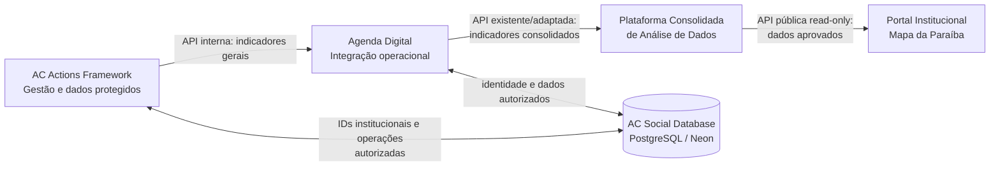

# Planejamento de Desenvolvimento — AC Actions Map | AC Social

**Versão:** 1.0  
**Data:** 25/10/2026  
**Estado:** planejamento técnico — **não iniciar a implementação sem autorização expressa**  
**Objetivo:** criar um novo framework de gestão de ações institucionais e participação de pessoas atendidas, preservando o desenho do ecossistema AC Social e migrando a administração atual do mapa de ações para fora do Portal Institucional.

> **Princípio central:** identidade institucional única; dados pessoais e operacionais protegidos; indicadores gerais transportados pelas APIs existentes; Portal Institucional apenas exibe conteúdo público aprovado.

## 1. Contexto e decisão arquitetural

O Portal Institucional da AC Social atualmente exibe um **mapa das ações realizadas na Paraíba**, e a gestão do conteúdo ocorre em seu painel administrativo. O objetivo deste projeto é transferir essa responsabilidade operacional para um **novo framework**, compatível com Agenda Digital e com a arquitetura de jornada unificada, sem eliminar o mapa público.

**Fluxo obrigatório estabelecido para dados gerais:**



O `usuario_id` da pessoa atendida é compartilhado **dentro dos domínios operacionais autorizados**. O pipeline de indicadores acima **não** transporta CPF, identificadores pessoais, prontuários, dados clínicos ou credenciais. O acesso dos demais frameworks ao cadastro institucional segue as permissões existentes; isso não é autorização para consultar prontuários de outros setores.

### Responsabilidades

| Componente | Responsabilidade | Fora do escopo |
|---|---|---|
| **AC Actions Framework** | Cadastrar ações, associar pessoas por `usuario_id`, gerir informações internas, validar/publicar ações e gerar indicadores seguros. | Hospedar o site público; reproduzir prontuários de Psicologia, Nutrição etc. |
| **AC Social Database** | Identidade central e tabelas específicas de domínio, sob controle de acesso. | Conceder acesso universal porque o banco é compartilhado. |
| **Agenda Digital** | Receber/validar os resumos autorizados do novo framework, registrar recebimentos e encaminhá-los pelo contrato de integração. | Armazenar novamente CPF ou a ficha completa da pessoa. |
| **Plataforma Consolidada de Análise de Dados** | Padronizar, consolidar, versionar e aprovar métricas para consumo interno/público. | Expor tabelas de pessoas ou prontuários ao público. |
| **Portal Institucional** | Consumir API pública de leitura e renderizar mapa e indicadores. | Executar CRUD de ações ou consultar diretamente as tabelas protegidas. |

**Observação importante:** o percurso por Agenda Digital é uma decisão explícita do projeto. Deverá ser mantido, mas cada salto deve ter finalidade definida, contratos versionados, validação, retries e idempotência para não criar fragilidade por dependências em cadeia.

## 2. Escopo e funcionalidades do MVP

### 2.1 Gestão de ações institucionais

- Criar, visualizar, editar, arquivar e pesquisar ações realizadas pela AC Social em municípios da Paraíba.
- Campos iniciais propostos: título, tipo/categoria, descrição interna, resumo público, município (código IBGE), local público aproximado quando apropriado, data/hora, equipe responsável, status, totalizações e observações internas.
- Estados: `rascunho`, `em_revisao`, `validada`, `publicada`, `arquivada` (ajustar à governança real da instituição).
- Registro da aprovação e de quem publicou; uma ação só pode chegar ao mapa após validação de seus campos públicos.
- Visualização em tabela paginada, filtros, busca e ficha detalhada, conforme permissões.
- Preview dos dados que o Portal Institucional receberá, sem expor dados privados.

### 2.2 Identidade e participação

- Buscar pessoa atendida pelo `usuario_id` institucional e por mecanismos seguros de pesquisa autorizada.
- Caso ainda não exista, chamar o fluxo institucional já aprovado para criação de usuário **na base central**, sem criar cadastro/credencial paralela.
- Associar uma ou várias pessoas à ação com um registro de participação, preservando o mesmo `usuario_id` utilizado por Nutrição, Psicologia, Serviço Social e demais frameworks.
- A mesma pessoa pode participar de várias ações; cada participação tem `participacao_id` próprio.
- Registro de ocorrências/atendimentos da ação somente com dados indispensáveis. Se houver atendimento técnico, manter o prontuário no domínio de origem e referenciá-lo por ID, quando permitido.
- Impedir duplicidade involuntária de participação no mesmo evento, sem apagar participações legítimas de atividades distintas.

### 2.3 Indicadores e mapa

- Quantidade de ações por município, categoria e período.
- Quantidade de participações/atendimentos, quando aplicável.
- Pessoas únicas atendidas: contar por `usuario_id` **antes de agregar**; definir se a deduplicação é por ação, mês, município ou período global, evitando somas incorretas.
- Somente dados aprovados e em granularidade segura saem para o pipeline público.
- Publicação das informações agregadas e dos resumos públicos dos eventos pela Plataforma Consolidada de Análise de Dados.
- O Portal Institucional mantém a experiência do mapa da Paraíba, mas passa a buscar os dados em um endpoint público de leitura, sem área de gestão direta.

### 2.4 Fora do MVP

- Prontuário clínico universal com acesso irrestrito.
- Reprodução de informações de Psicologia, Nutrição ou ABA dentro deste framework.
- Novo serviço de login ou nova tabela de senhas.
- Exposição pública de CPF, nome de atendido, `usuario_id`, laudos, detalhes dos atendimentos, endereço de beneficiários ou coordenadas de residências.
- Substituição das APIs atuais sem inventário técnico e planejamento de compatibilidade.

## 3. Stack padronizada

| Camada | Tecnologias | Diretriz |
|---|---|---|
| Frontend | **Next.js (App Router), React, TypeScript estrito, Tailwind CSS** | Seguir padrões AC Social e design minimalista, responsivo e acessível. |
| Interface | **Material UI (MUI)**, React Icons, React Hot Toast | Componentes, diálogos, tabelas, ícones e feedback consistentes. Reutilizar tema/tokens existentes. |
| Dados do frontend | **TanStack React Query + Axios** | Busca, cache, invalidação, mutações e tratamento padronizado de erros. |
| Formulários | **React Hook Form + Zod** | Validação no cliente; FastAPI revalida tudo no servidor. |
| Backend | **Python + FastAPI + Pydantic** | APIs de domínio, regras de negócio, permissões e integrações. |
| Persistência | **SQLAlchemy + Alembic** | Consultas, transações e migrações das novas tabelas, preservando o schema existente. |
| Banco | **AC Social Database — PostgreSQL/Neon** | Mesma instância institucional; tabelas próprias do módulo e relacionamentos com cadastro existente. |
| Analytics | **SQL**, Pandas/NumPy apenas quando necessários | Agregação preferencialmente no backend/plataforma analítica; evitar processamento sensível no navegador. |
| Infraestrutura | **Vercel para frontend**, serviço compatível para FastAPI conforme infraestrutura atual | Segredos no servidor; staging e produção isolados; não pressupor configuração de deploy do backend. |
| Testes/qualidade | pytest, testes de integração, Playwright, ESLint, verificação TypeScript | Cobrir autorização, integrações, regressões e fluxo completo. |

**Não definir versões de dependências nem criar tabelas definitivas sem antes inspecionar os repositórios e os contratos de APIs do ecossistema.**

## 4. Arquitetura interna e separação de domínio

Adotar **Clean Architecture**, com separação de apresentação, casos de uso, domínio e infraestrutura. Manter o framework como aplicação modular; não há necessidade de microserviços adicionais apenas para esse recurso.

```text
ac-actions-framework/
  frontend/
    app/
      (auth)/login/
      (app)/dashboard/
      (app)/acoes/
      (app)/acoes/[id]/
      (app)/usuarios/
      (app)/indicadores/
      (app)/integracoes/
      (app)/tecnologia/conexao/
    components/
    features/acoes/ features/participacoes/ features/indicadores/
    lib/api/ lib/auth/ lib/query/
    styles/
  backend/
    app/api/v1/
    app/domain/
    app/application/
    app/infrastructure/db/
    app/infrastructure/integrations/
    app/security/
    tests/
    alembic/
  docs/
    arquitetura.md
    matriz-de-permissoes.md
    contratos-api.md
    privacidade-e-retencao.md
    plano-de-migracao.md
  .env.example
```

Reutilizar autenticação/sessão AC Social existente. Identificar separadamente **profissional autenticado** (`profissional_id`) e **pessoa atendida** (`usuario_id`); os dois IDs não são intercambiáveis. Cookies seguros/HttpOnly, proteção CSRF conforme estratégia de sessão, CORS com origens explícitas, token de serviço para API-to-API, limites de requisição e validação por recurso.

## 5. Modelo conceitual de dados

**ATENÇÃO:** nomes abaixo são **propostas**, não afirmações sobre o schema de produção. Levantar nomes reais, constraints e chaves antes de criar migrações.

### 5.1 Referências compartilhadas já existentes

- `usuarios`: pessoa atendida, com `usuario_id` UUID único e imutável (ou a chave real equivalente).
- `profissionais`, `equipes`, `permissoes`, `auth`: identidades e acesso já institucionalizados.
- `atendimentos`, `historico_eventos`: relacionamentos ou contratos institucionais, somente se já existirem e forem compatíveis.

O CPF permanece, se necessário à finalidade, no cadastro institucional protegido. O novo módulo pode **consultar/atualizar o cadastro mestre apenas via acesso autorizado**, mas **não deverá duplicar CPF** nas tabelas de ações. Para busca por CPF, nunca expor documento completo em listagens, logs ou parâmetros públicos.

### 5.2 Tabelas novas propostas

```text
acoes_institucionais
- id UUID (PK)
- titulo
- categoria
- descricao_interna           # acesso restrito
- resumo_publico              # conteúdo editorial aprovado
- municipio_ibge              # código oficial, não texto livre como chave
- local_publico_aproximado    # opcional, só se adequado
- data_inicio, data_fim
- status
- responsavel_profissional_id # FK profissional institucional
- criado_por, atualizado_por, aprovado_por
- publicado_em, criado_em, atualizado_em

participacoes_acoes
- id UUID (PK)
- acao_id UUID (FK -> acoes_institucionais)
- usuario_id UUID (FK -> usuarios existente)
- data_participacao
- tipo_participacao
- atendimento_id              # opcional, caso contrato autorize
- observacao_operacional      # proteger; evitar dados clínicos
- criado_por, criado_em

resumos_acoes
- id UUID (PK)
- periodo_inicio, periodo_fim
- municipio_ibge
- categoria
- quantidade_acoes
- quantidade_participacoes
- quantidade_usuarios_distintos
- versao_calculo
- status_publicacao
- calculado_em, aprovado_em

integracoes_outbox_acoes
- id UUID (PK)
- evento_tipo
- versao_schema
- idempotency_key UNIQUE
- payload_geral_sem_pii
- status_envio
- tentativas, proxima_tentativa_em, enviado_em
- erro_sanitizado

auditoria_acoes
- id UUID (PK)
- profissional_id
- operacao
- entidade_tipo, entidade_id
- data_hora
- metadata_minima_sem_pii
```

**Índices/constraints importantes:** `(acao_id, usuario_id)` exclusivo quando representar uma participação única; índices por município, data, status, FK e filtro; `CHECK`s para estados válidos; timestamps consistentes com UTC no banco e apresentação no fuso `America/Fortaleza`.

Caso a arquitetura institucional mantenha separação por schemas PostgreSQL (`core`, `acoes`, `agenda`, etc.), seguir a convenção já adotada. O mesmo banco não implica credenciais nem permissões irrestritas entre schemas.

## 6. Contratos de API — propostas a validar

Todos os caminhos e payloads aqui são **novos contratos sugeridos**, não endpoints existentes confirmados.

### 6.1 API privada do AC Actions Framework

| Método / rota sugerida | Objetivo | Controle |
|---|---|---|
| `GET /api/v1/acoes` | Listar e filtrar ações. | Sessão institucional + escopo autorizado. |
| `POST /api/v1/acoes` | Criar ação em rascunho. | `acoes.create`. |
| `GET /api/v1/acoes/{id}` | Consultar ação e dados permitidos. | `acoes.read` + escopo por recurso. |
| `PATCH /api/v1/acoes/{id}` | Atualizar dados operacionais. | `acoes.update`. |
| `POST /api/v1/acoes/{id}/participacoes` | Associar `usuario_id` à ação. | `participacoes.write`. |
| `POST /api/v1/acoes/{id}/aprovar` | Aprovar dados gerais/publicáveis. | `acoes.approve`. |
| `POST /api/v1/acoes/{id}/publicar` | Marcar ação como publicável. | `acoes.publish`, aprovação prévia. |
| `GET /api/v1/indicadores` | Indicadores internos autorizados. | `indicadores.read`. |
| `GET /api/v1/integracoes/status` | Mostrar status sanitizado. | Tecnologia. |

### 6.2 Framework → Agenda Digital

**Sugestão:** `POST /api/integracoes/v1/acoes/resumos` na Agenda Digital, ou adaptar ao endpoint institucional existente, caso já haja receptor padronizado.

Exemplo **fictício, apenas de estrutura**:

```json
{
  "schema_version": "1.0",
  "event_id": "3b51c7ef-d8d2-4270-b87a-41ea75a10192",
  "source": "ac-actions-framework",
  "periodo": {"inicio": "2026-10-01", "fim": "2026-10-31"},
  "municipio_ibge": "2507507",
  "categoria": "acao_institucional",
  "quantidade_acoes": 3,
  "quantidade_participacoes": 57,
  "quantidade_usuarios_distintos": 49,
  "publicavel": false,
  "calculo_versao": 1
}
```

Esse objeto **não contém nome, CPF, `usuario_id`, coordenada privada ou informação clínica**. Os valores são demonstrativos, não dados reais. Um evento de sincronização pode ser interno mesmo quando `publicavel=false`: a aprovação pública é um processo separado.

**Controle do transporte:** HTTPS, autenticação serviço-a-serviço (credencial de escopo mínimo armazenada no backend), validação Pydantic/OpenAPI, idempotency key, retentativas com backoff, fila/outbox transacional e observabilidade sem payload sensível nos logs. Recepção retorna confirmação inequívoca antes de marcar o evento como entregue; falhas não impedem salvar a ação, mas ficam visíveis na área técnica.

### 6.3 Agenda Digital → Plataforma Consolidada de Análise de Dados

- Reutilizar a integração real, identificada a partir dos códigos e da documentação.
- Acrescentar o tipo de fonte `ac-actions-framework` e versão do contrato sem quebrar consumidores existentes.
- Verificar se Agenda Digital deve encaminhar resumos originais ou consolidar; **não duplicar contagens** ao cruzar com seus próprios atendimentos.
- Salvar comprovante de recepção/idempotência e conciliar quantidade de eventos publicados versus recebidos.

### 6.4 Plataforma → Portal Institucional

**Sugestão de contrato público:** `GET /api/public/v1/mapa-acoes?estado=PB&periodo=2026-10`.

```json
{
  "atualizado_em": "2026-10-25T17:00:00-03:00",
  "estado": "PB",
  "municipios": [
    {
      "municipio_ibge": "2507507",
      "nome": "João Pessoa",
      "quantidade_acoes": 3,
      "quantidade_participacoes": 57,
      "resumos_publicos": [
        {"titulo": "Ação comunitária", "mes": "2026-10"}
      ]
    }
  ]
}
```

Exemplo demonstrativo. O endpoint público aplica **allowlist de campos**, verifica status de publicação, remove células com risco de identificação por baixo volume ou combina faixas geográficas/temporais, e devolve apenas dados aprovados. **Não exportar a tabela original de ações e confiar que o frontend esconderá colunas.**

## 7. Autenticação, segurança, LGPD e acesso

1. **Autenticação institucional reutilizada**; não gerar segundo cadastro de funcionários/senhas.
2. **RBAC + ABAC no backend**: permissão por função/equipe, domínio e recurso; ocultar telas no frontend é apenas melhoria de UX, não substitui validação.
3. **Matriz provisória**: Atendimento registra participação; Coordenação revisa e aprova ações; Tecnologia configura integração e observa falhas; Leitura/Auditoria consulta apenas escopos permitidos. Os papéis reais devem seguir a documentação de `equipes` e aprovação da instituição.
4. **Prontuário protegido por domínio**: ter `usuario_id` comum não autoriza leitura de notas psicológicas, diagnósticos, anamneses ou documentos de outro framework. Na jornada unificada, mostrar existência de evento apenas conforme permissão.
5. **Minimização de dados**: CPF e outros identificadores só na base institucional e nas rotas privadas estritamente justificadas. Evitar dado pessoal em URLs, logs, analytics de frontend, cache compartilhado e traces.
6. **Medidas técnicas**: criptografia em trânsito e em repouso, segregação de credenciais e privilégios do banco, backups com restauração testada, segredos fora do repositório, limitação de tentativas e auditoria dos acessos sensíveis.
7. **Governança**: documentar finalidade/base legal com a instituição, classificação dos dados, retenção/descarte, transparência ao titular, eventual relatório de impacto conforme avaliação de risco, tratamento de incidentes e procedimento de publicação.
8. **Publicação segura**: agregação não assegura anonimização automaticamente; avaliar células pequenas e combinações de indicadores que permitam reidentificação.
9. **Privacidade de crianças e PcD**: proteção adequada ao contexto dos atendidos; evitar exibição de localização ou informação que revele condição pessoal.

A ANPD recomenda controles de **autenticação, autorização e auditoria** e políticas proporcionais ao risco. Ver materiais oficiais: [Guia de segurança da ANPD](https://www.gov.br/anpd/pt-br/centrais-de-conteudo/materiais-educativos-e-publicacoes/guia-orientativo-sobre-seguranca-da-informacao-para-agentes-de-tratamento-de-pequeno-porte) e [Regulamento para agentes de pequeno porte](https://www.gov.br/anpd/pt-br/acesso-a-informacao/institucional/atos-normativos/regulamentacoes_anpd/resolucao-cd-anpd-no-2-de-27-de-janeiro-de-2022). O plano não substitui validação jurídico-institucional da LGPD.

## 8. Navegação e design system

**Direção visual:** interface AC Social minimalista, fundo predominantemente claro, tipografia legível e cores consistentes com os tokens atuais; uso moderado de cinzas e estados sem depender apenas de cor. Sidebar padrão dos frameworks, cabeçalho de contexto, grid responsivo e componentes reutilizáveis.

| Rota | Tela | Requisitos centrais |
|---|---|---|
| `/dashboard` | Visão geral | Ações realizadas, municípios, pendências, resumos operacionais. |
| `/acoes` | Gestão | Filtros, paginação, estado vazio, botões condicionados a permissões. |
| `/acoes/nova` | Cadastro | Formulário em etapas com validação e salvamento de rascunho. |
| `/acoes/[id]` | Detalhes | Participações, histórico, revisão e aprovação. |
| `/usuarios` | Busca/vínculo | Busca de cadastro institucional autorizado, associação sem duplicação. |
| `/indicadores` | Métricas | Filtros e agregações internas; rótulos de período e atualização. |
| `/integracoes` | Sincronização | Últimos envios e falhas, visão conforme perfil. |
| `/tecnologia/conexao` | Diagnóstico técnico | **Somente equipe Tecnologia**, com validação também no FastAPI. |

Incluir atalho para Agenda Digital. React Query gerencia cache de listagens e indicadores; invalidar queries após mutações. Formulários com RHF/Zod, feedback com React Hot Toast, tabelas e diálogos com MUI. Acessibilidade: teclado, labels, mensagens de erro, foco, contraste, leitura por tecnologias assistivas e experiência móvel. Se houver preview cartográfico no framework, reutilizar o formato GeoJSON/IBGE e o componente já adotado no portal quando tecnicamente possível; o mapa público continua responsabilidade do portal.

## 9. Migração do mapa atualmente gerido pelo Portal

1. Inventariar **tabelas, telas, APIs, validações e registros** existentes do mapa, inclusive campos públicos, status, anexos e ligações a atendidos.
2. Tirar **backup validado** e registrar contagens/checksums; nunca migrar diretamente sem plano de reversão.
3. Mapear cada registro existente para `acoes_institucionais`, distinguindo campos internos e públicos. **Não inventar `usuario_id` em registros históricos sem correspondência verificada.**
4. Criar script de importação **idempotente**, em staging, com tabela de correspondência `legacy_id → acao_id`, logs sanitizados e relatório de exceções.
5. Implementar o novo CRUD, revisar permissões e testar que o Framework passa a ser o **único escritor** das ações após a virada.
6. Sincronizar indicadores pelo fluxo Framework → Agenda → Analytics e confrontar dados do mapa antigo com a nova API pública.
7. Fazer migração gradual: manter leitura antiga temporariamente como fallback **sem dois painéis gravando**; trocar a origem do mapa por feature flag/configuração.
8. Verificar dados exibidos, acessibilidade, desempenho e estabilidade. Após aceitação, desativar o CRUD antigo do portal e retirar permissões/tokens obsoletos.
9. Roteiro de rollback: reverter apenas a **origem de leitura** do portal para snapshot previamente validado; não reabrir edição concorrente sem reconciliar dados.

## 10. Etapas de trabalho e entregáveis

### Fase 0 — Descoberta e compatibilidade

- Ler os repositórios e contratos existentes de Agenda Digital, Portal, Analytics, AC Social Database e framework-base (ABA/Social).
- Confirmar identidade `usuario_id`, entidades reais, autenticação/roles, APIs, hospedagem, esquema e migrações em produção.
- Documentar quem é dono de cada dado e a matriz de permissão.

**Entrega:** diagrama validado, inventário e contratos de integração aprovados. **Gate:** nenhuma alteração em tabelas compartilhadas antes dessa revisão.

### Fase 1 — Fundação do novo framework

- Inicializar Next.js/TypeScript/Tailwind/MUI/React Query/Axios e FastAPI/Pydantic/SQLAlchemy/Alembic.
- Reaproveitar login, perfil, equipes/permissões, shell/sidebar AC Social e cliente API.
- Configurar CI, ambientes, healthcheck e testes básicos.

**Entrega:** aplicação navegável e autenticada, sem dados de produção expostos.

### Fase 2 — Domínio de ações e vínculos

- Criar migrações isoladas das tabelas aprovadas e CRUD de ações.
- Vincular participações pelo `usuario_id` já existente; implementar busca segura, prevenção de duplicidade, auditoria e filtros.
- Criar telas de aprovação e revisão de resumo público.

**Entrega:** criação/edição, vínculo e publicação controlada em staging.

### Fase 3 — Indicadores e integração sequencial

- Definir semântica de cada contador e política de supressão de dados.
- Criar resumos sem PII e outbox transacional no Framework.
- Integrar recebimento idempotente na Agenda Digital e encaminhamento pela API existente à Plataforma Consolidada.
- Construir painel de estado das integrações e reconciliação de resultados.

**Entrega:** mesmo resumo chega à Plataforma uma única vez do ponto de vista lógico, mesmo após retries.

### Fase 4 — Portal e migração histórica

- Criar/validar API pública na Plataforma de Análise com allowlist e aprovação.
- Adaptar apenas a **leitura** do mapa da Paraíba no Portal Institucional.
- Importar dados legados, comparar contagens e realizar virada gradual.

**Entrega:** mapa funcionando sem painel de edição no Portal e sem dados privados no payload público.

### Fase 5 — Homologação e produção

- Testes de segurança, regressão, carga básica, fluxos de erro e acessibilidade.
- Testar backup/restauração, rollback, expiração de sessão, logs, retries e publicação.
- Homologação pela Tecnologia, Coordenação e responsável por proteção de dados; deploy controlado.

**Entrega:** operação acompanhada, documentação técnica e checklist de produção.

## 11. Cenários de testes obrigatórios

- Uma pessoa com `usuario_id` único participa de uma ação e já possui registro no Framework de Nutrição; a identidade é reconhecida sem duplicação e o novo sistema não consegue acessar conteúdo clínico sem autorização.
- Duas ações diferentes têm a mesma pessoa; contagem de participações e contagem de **pessoas únicas** apresentam números coerentes.
- Operador sem permissão tenta consultar registro, aprovar ação, publicar resumo ou acessar rota técnica: resposta 403; não há vazamento.
- Chave de integração expira ou Agenda Digital fica indisponível: registro operacional continua íntegro; mensagem de falha e retry idempotente.
- Reenvio duplicado não incrementa duas vezes os indicadores na Plataforma Consolidada.
- Portal recebe somente métricas/campos permitidos; testes verificam ausência de CPF, nome, `usuario_id`, e-mail, telefone, notas e IDs de prontuários.
- Uma ação não aprovada não aparece no mapa; uma ação alterada após aprovação exige revisão segundo política definida.
- Município/IBGE inválido é rejeitado; mapa permanece útil em desktop, celular, teclado e leitores de tela.
- Migração de legado preserva quantidades, autoria/status possíveis, e os itens sem correspondência ficam em relatório de exceções em vez de serem associados a outra pessoa.

## 12. Critérios de aceite para o MVP

- [ ] A AC Social mantém **uma única identidade por pessoa** (`usuario_id`) reutilizada entre frameworks.
- [ ] O AC Actions Framework gerencia ações/participações no banco institucional com permissões verificadas no backend.
- [ ] CPF e dados sensíveis ficam fora de cada payload do pipeline público de indicadores.
- [ ] Framework → Agenda Digital → Plataforma de Análise → Portal funciona por contratos documentados, autenticação e idempotência.
- [ ] O mapa da Paraíba continua atualizado e apresenta **somente informações publicáveis**.
- [ ] O Portal Institucional não possui CRUD próprio de ações após a migração.
- [ ] Há trilha de auditoria, testes, monitoramento, backup e estratégia de reversão.
- [ ] Design responsivo, acessível e compatível com os padrões visuais dos frameworks AC Social.

## 13. Primeira atividade de desenvolvimento recomendada

**Antes de escrever código**, reunir em uma pasta de referência: schema real de AC Social Database, rotas/auth da Agenda Digital, APIs da Plataforma Consolidada de Análise de Dados, arquivos do mapa atual e tokens/componentes visuais de ABA/Social Framework. Produzir então um **contrato OpenAPI de integração** e um **mapeamento do legado**. Isso evita introduzir nomes de tabelas, credenciais e endpoints incompatíveis com o ecossistema já em funcionamento.

**Condição de execução:** este arquivo é um planejamento; nenhuma aplicação, migração, integração ou deploy foi realizado como parte de sua elaboração.
