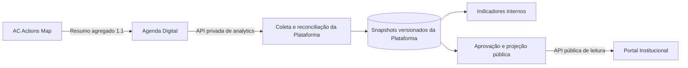

# Plano de implementação — ações institucionais na Plataforma Consolidada

> **Novos metadados de 30/10:** complementar este plano com
> [APIs e aplicações consumidoras](INTEGRACAO_NOVOS_METADADOS_E_CONSUMIDORES.md),
> especialmente as seções 5.3 (coleta/projeção), 7 (ranking sem dupla contagem)
> e 8 (ordem de implantação). Nome/número/autor, parceiros e logos exigem contrato
> novo; não existem nos itens 1.1. Não presumir pessoas únicas pela soma das ações.

> **Atualização da descoberta em 30/10/2026:** a rota de exportação congelada v2
> proposta abaixo foi localizada no código da Agenda Digital, em
> `src/app/api/analytics/v2/acoes/route.ts`, com `domain/frozenExport.ts`.
> Portanto, “ainda não existente” descreve a elaboração de 26/10, não o código
> atual inspecionado. Confirmar implantação/contrato antes do consumidor; não
> criar uma rota duplicada. [Inventário e limites da conferência](FASE_0_DESCOBERTA_2026-10-30.md).

**Data:** 26/10/2026 · **Versão:** 1.0

**Workspace de destino:** `plataformaconsolidadadedados`

**Estado:** plano para implementação; este documento não ativa a integração nem altera produção.

## 1. Resultado esperado

Integrar os resumos do AC Actions Map à Plataforma Consolidada de Análise de Dados, por meio da Agenda Digital. Exibir quantidade de ações, pessoas contempladas e municípios, com origem, revisão, qualidade e atualização verificáveis. Preparar a projeção pública que futuramente alimentará o Portal Institucional.

O caso inicial é **Melhor Visão: 50 pessoas contempladas, 1 ação, Mamanguape/PB, IBGE 2508901**. As datas são desconhecidas e devem permanecer nulas. Esses números são uma referência de conferência em 26/10/2026, nunca constantes de implementação. Se houver atualização legítima posterior, prevalece a revisão atual da fonte.



**Princípios obrigatórios:** preservar o fluxo acima; identidade institucional existente; acesso por função/equipe no servidor; contratos versionados; separação entre dados internos e públicos; auditoria; idempotência; minimização; falhas explícitas; escritor único para as ações. A Plataforma não recebe fichas, nomes de beneficiários, CPF, IDs individuais, prontuários ou credenciais de profissionais.

## 2. Situação verificada e limites

| Componente | Situação em 26/10/2026 |
| --- | --- |
| Map → Agenda | Implementado e conferido em produção; Melhor Visão publicada, revisão 9, ACK recebido e GET independente correspondente |
| Agenda → Plataforma | Exportação disponível; consumidor de ações ainda ausente na Plataforma |
| Plataforma atual | Já consulta atendimentos da Agenda e analytics do Acesso Digital |
| Plataforma → Portal para estas ações | Ainda não implementado/validado |
| Estado de rascunho no Map | Removido; não recriar esse estado na integração |

O título “Melhor Visão” é contexto humano desta conferência. **Título, descrição e resumo editorial não integram o payload atual.** Não derivar textos públicos desses campos inexistentes nem consultar o Map diretamente para obtê-los.

O identificador de transporte vigente é **`ac-actions-map`**, contrato **`1.1`**. A menção antiga a `ac-actions-framework` no planejamento original não autoriza alterar o identificador real. Se necessário, usar esse nome somente como alias interno documentado, preservando `source` recebido.

## 3. Arquitetura real a preservar

Antes de editar código, ler `AGENTS.md`, `CLAUDE.md`, README e os guias relevantes em `node_modules/next/dist/docs/`, conforme as regras locais. Confirmar versões instaladas; não atualizar dependências como parte desta integração sem necessidade demonstrada.

O repositório da Plataforma possui Next.js/TypeScript/MUI/React Query no frontend, FastAPI/Python para cálculos analíticos e PostgreSQL para persistência institucional. O alias `@/application/*` aponta para `backend/legacy/application/*`; `@/infrastructure/*` aponta para `backend/legacy/infrastructure/*`. O nome `legacy` não significa código fora de uso.

| Arquivo/diretório existente | Responsabilidade atual e cuidado |
| --- | --- |
| `backend/legacy/infrastructure/apis/cliente-apis-analiticas.ts` | Clientes de atendimentos da Agenda e Acesso; preservar seus endpoints, semântica e credenciais |
| `backend/legacy/application/dashboards/obter-dashboard-interativo.ts` | Reúne fontes atuais; evitar inserir ações nas séries clínicas existentes |
| `frontend/src/domain/dashboards/tipos.ts` | Tipos dos indicadores atuais; não forçar o novo domínio a ter demografia ou ranking clínico |
| `backend/app/analytics.py` e `warehouse.py` | Cálculos e qualidade; acrescentar funções de ações separadas quando necessário |
| `frontend/src/server/external-api/*` | Autenticação e projeção da API externa; reutilizar controles, sem ampliar escopos implicitamente |
| `frontend/src/app/api/dashboards/route.ts` | Rota pública existente; não espalhar objetos internos de ações na resposta |
| `frontend/src/app/api/warehouse/*` e `/backend` | Diagnóstico restrito à equipe Tecnologia |
| `contracts/external-api-v1.openapi.json` | API externa existente; preservar compatibilidade |
| `contracts/api-integridade-baseline.json` | Não relaxar critérios das fontes atuais para acomodar a nova fonte |

Criar um módulo próprio de ações. Proposta de organização, sujeita às convenções confirmadas no workspace:

```text
frontend/src/domain/acoes/                    # contrato, tipos e regras puras
backend/legacy/application/acoes/             # casos de uso e portas
backend/legacy/infrastructure/acoes/          # cliente Agenda e repositório SQL
frontend/src/server/acoes/                    # configuração e adaptadores do BFF
frontend/src/app/api/warehouse/acoes/         # operação interna autorizada
frontend/src/interface/components/acoes/     # indicadores e diagnóstico
backend/app/acoes.py                         # cálculos separados, se necessários
contracts/agenda-acoes-1.1.schema.json        # contrato de entrada congelado
contracts/acoes-publicas-v1.openapi.json      # contrato público futuro
docs/integracao-acoes-institucionais.md       # operação, decisões e recuperação
```

Esses novos caminhos são propostas, não arquivos já existentes. Domínio não depende de HTTP, SQL ou React. Casos de uso dependem de portas; adaptadores cuidam de rede/persistência. Agregar no servidor, usando SQL/Python conforme o desenho existente. O navegador recebe somente projeções necessárias.

## 4. Contrato disponível na Agenda

**Endpoint existente:** `GET https://agenda-digital-ac-social.vercel.app/api/analytics/acoes?page=1`.

Autenticação: chave institucional de exportação de analytics da Agenda. A Plataforma já possui a configuração `INTEGRACAO_API_AGENDA_DIGITAL`; validar sua correspondência com `ANALYTICS_EXPORT_API_KEY` da Agenda sem imprimir valores. O endpoint aceita `Authorization: Bearer <segredo>` ou `x-api-key`. Preferir Bearer no novo cliente; preservar os headers do cliente antigo.

**Não usar** `AGENDA_SERVICE_TOKEN` do Map, `ACTIONS_MAP_TOKEN_SHA256`, senha de profissional ou cookie de sessão para esta coleta. O GET `/api/integracoes/v1/acoes/resumos` usa a credencial do Map e não é a API de leitura da Plataforma.

Resposta atual, ilustrada com o snapshot de referência:

```json
{
  "schema_version": "1.1",
  "source": "ac-actions-map",
  "page": 1,
  "page_size": 100,
  "escopo": "ações publicadas; pessoas contadas dentro de cada ação, sem deduplicação entre ações",
  "quantidade_acoes": 1,
  "quantidade_pessoas_contempladas": 50,
  "items": [
    {
      "schema_version": "1.1",
      "event_id": "d2e316e8-e289-4289-ae29-32d4cb73eaaf",
      "source": "ac-actions-map",
      "acao_id": "51a6a0db-64f2-5b7b-ad1f-14acf13948c1",
      "revisao": 9,
      "operacao": "upsert",
      "categoria": "Saúde visual",
      "inicio_em": null,
      "fim_em": null,
      "municipios_ibge": ["2508901"],
      "quantidade_acoes": 1,
      "quantidade_participacoes": 50,
      "quantidade_pessoas_contempladas": 50,
      "publicavel": true
    }
  ]
}
```

O `event_id` acima é ilustrativo; obter o valor real na coleta. O exemplo não contém dados individuais.

Regras do contrato de cada item:

- Exatamente os 14 campos ilustrados, sem propriedades adicionais. Fonte e versão exatas; IDs técnicos em formato UUID.
- Revisão inteira positiva; quantidades inteiras não negativas, até 2147483647; pessoas contempladas não excedem participações.
- `upsert` exige `quantidade_acoes=1`. `archive` exige quantidades zero e `publicavel=false`.
- Categoria textual com até 80 caracteres. Datas reais `YYYY-MM-DD` ou `null`; fim exige início e não pode precedê-lo.
- Lista não vazia, sem repetição, de até 223 municípios do catálogo oficial da Paraíba. Validar o catálogo, não apenas sete dígitos; normalizar a ordem para comparação/hash.
- A exportação atual inclui somente itens `publicavel=true`. Validar também o envelope, tipos, limites de tamanho e versão. Campos/versões futuros exigem evolução explícita do contrato, não coerção silenciosa.

Os totais do envelope são globais e se repetem nas páginas. **Nunca somá-los página a página.** A resposta atual não fornece `has_next`, `total_pages`, cursor, tombstones ou identificador de uma exportação congelada. Não presumir esses campos.

## 5. Dependência crítica: consistência e retirada de ações

A exportação atual filtra `publicavel=true`. Uma ação editada, arquivada ou com publicação retirada desaparece dessa lista. Um consumidor que apenas faz upsert manteria números antigos indefinidamente.

Há também paginação por `OFFSET`, com consultas separadas de totais e itens. O adaptador abre transação `READ ONLY`; isso, isoladamente, não assegura um mesmo snapshot entre consultas ou requisições. Comparar totais de duas leituras não prova estabilidade: ações diferentes podem trocar de elegibilidade mantendo as mesmas quantidades.

**Decisão deste plano:** consolidar a partir de uma **exportação completa e consistente**, promovida atomicamente. Antes de ativar a coleta como fonte autoritativa, implementar/homologar na Agenda a extensão abaixo ou registrar uma alternativa com garantia equivalente. O desenvolvimento da Plataforma pode avançar com fixtures e em modo de conferência enquanto isso; não declarar o fluxo de produção concluído sem resolver esta dependência.

Contrato proposto, **ainda não existente**, para a Agenda:

1. Nova rota versionada `GET /api/analytics/v2/acoes`, preservando integralmente a rota 1.1 e os endpoints de atendimentos.
2. Primeira página materializa uma exportação imutável de todas as ações publicadas, com leitura consistente. Retorna `exportacao_id`, `geracao` monotônica atribuída de forma consistente com o snapshot, `capturado_em`, `expira_em`, `total_itens`, totais, `page_size`, `total_pages` e checksum canônico documentado do conjunto. Os itens continuam no contrato 1.1.
3. Páginas seguintes exigem o mesmo `exportacao_id`, autenticação e versão. Ordenação determinística e conteúdo congelado; mudanças posteriores aparecem em outra exportação. Paginação nunca mistura gerações.
4. Manifesto completo com zero itens representa conjunto vazio válido. Exportação expirada responde 410; o consumidor descarta o staging e reinicia, sem promover páginas parciais.
5. Documentar limites de tamanho, prazo de expiração, quotas e expurgo do armazenamento agregado temporário. Não deixar transação PostgreSQL aberta entre requisições HTTP.
6. Versionar esquema/OpenAPI e testes da extensão no workspace da Agenda. O envelope v2 deve ter schema próprio; não mudar o significado de `schema_version: "1.1"` dos itens.

Uma alternativa aceitável é feed incremental com cursor consistente, eventos de retirada e mecanismo de recuperação de lacunas. Escolher/documentar uma estratégia antes do código; não implementar duas estratégias incompletas. A proposta principal deste plano é a exportação congelada.

**Limite de responsabilidade:** esta dependência exige trabalho no workspace da Agenda. Anexar o plano à Plataforma não altera esse outro projeto automaticamente. Registrar o requisito no handoff e coordenar a implantação antes de ativar a promoção na Plataforma.

## 6. Semântica das métricas e filtros

| Medida/recorte | Regra obrigatória |
| --- | --- |
| Ações globais | Contar a revisão corrente elegível de cada `(source, acao_id)` uma única vez |
| Pessoas contempladas | Distintas dentro de cada ação; soma entre ações deve ser rotulada “pessoas contempladas nas ações, sem deduplicação entre ações” |
| Participações | Manter separadas de pessoas e de atendimentos clínicos |
| Fontes clínicas/Acesso | Não somar automaticamente a nova métrica às séries atuais; não há chave para deduplicação entre domínios |
| Ações por município | Contar ações distintas que incluem o município; a soma municipal pode exceder o total global |
| Pessoas por município | Somente ações de município único permitem atribuição direta. Em ações com vários municípios, manter bloco “sem distribuição municipal” e não dividir nem replicar seu total |
| Datas ausentes | Mostrar “Data não informada”; não usar data do upload, publicação ou coleta como data da ação |
| Série temporal | Incluir apenas datas conhecidas; manter quantidade de ações sem data e cobertura explícitas |
| Ação com período | Proposta: atribuir uma vez ao mês de início, com rótulo documentado. Não repetir o total em cada mês. Validar essa convenção antes de ativar o filtro temporal |
| Demografia | Não há dados de gênero, idade ou PcD nesta fonte; indicar “não disponível”, sem fabricar categorias |

Não importar as exigências clínicas de ranking/demografia/cobertura mensal para a nova fonte. Configurar critérios próprios sem afrouxar os baselines das fontes existentes. Zero verificado, dado ausente, distribuição desconhecida e fonte indisponível são estados diferentes.

## 7. Persistência, idempotência e reconciliação

Criar estrutura própria por migração administrativa versionada, após inventário do banco real. Nomes sugeridos, não tabelas existentes:

- `plataforma_acoes.coletas`: execução, exportação de origem, versão, checksum, contagens, início/fim, estado, erro seguro e ator/agendador.
- `plataforma_acoes.staging`: itens por execução, com unicidade `(coleta_id, source, acao_id)`; sem dados individuais.
- `plataforma_acoes.snapshots`: revisão corrente, hash canônico, conteúdo agregado, elegibilidade na origem, última coleta e estado de retirada.
- `plataforma_acoes.revisoes`: recibos imutáveis por `(source, acao_id, revisao)` e unicidade de evento; conflito de conteúdo nunca sobrescreve silenciosamente.
- `plataforma_acoes.publicacoes`: aprovação da projeção pública vinculada ao hash/revisão, ator, data, versão do cálculo e revogação.
- Auditoria restrita das sincronizações, aprovações, conflitos e retiradas.

Reutilizar mecanismos existentes quando adequados, mantendo isolamento lógico e privilégios mínimos. DDL fora do startup/build; runtime sem permissão para migrar schema. Não alterar tabelas clínicas, credenciais, profissionais, equipes ou RLS. Backup cifrado verificado, revisão dos grants e ensaio de recuperação precedem migração produtiva.

Algoritmo de sincronização:

1. Autorizar o operador/agendador; obter lock/lease por fonte, sem segurar transação SQL durante chamadas externas. Impedir promoção por trabalhador cujo lease expirou.
2. Abrir execução, obter manifesto consistente e registrar a geração de origem. Uma execução antiga não pode promover depois de outra mais recente; usar fencing/CAS e estado da execução.
3. Buscar todas as páginas com timeout, limites de bytes/itens, HTTPS e redirecionamento bloqueado. Validar cada página e item antes do staging.
4. Conferir quantidade de itens únicos, checksum, identidade da exportação e totais globais. Erro em qualquer página torna a execução incompleta; não alterar o conjunto vigente.
5. Mesma revisão/evento e mesmo conteúdo: repetição sem novo efeito. Revisão/evento repetido com conteúdo diferente: conflito auditado. Revisão menor nunca substitui revisão maior. Uma exportação antiga ou regressiva não pode promover por ter terminado por último.
6. Em transação curta, promover o conjunto completo e marcar como não elegíveis os registros da fonte ausentes nessa exportação. A ausência comprova retirada de elegibilidade, não exclusão física nem motivo específico de arquivamento.
7. Vincular recibo da coleta à promoção, atualizar indicadores e invalidar caches. Alteração ou retirada invalida imediatamente a aprovação pública anterior correspondente.
8. Commit antes de informar sucesso. Repetir a mesma exportação não altera totais nem duplica auditoria de efeito lógico. Preservar o histórico das tentativas.

Falhas temporárias devem preservar o último conjunto válido e sua data real de coleta. Exibir estado degradado; não retornar dados antigos como recém-atualizados. Para divulgação pública, definir prazo máximo de validade e política de retirada: sem garantia de atualização, suspender a projeção após esse prazo em vez de expor indefinidamente uma aprovação possivelmente revogada.

## 8. Configuração, operação e interface

Reaproveitar `INTEGRACAO_API_AGENDA_DIGITAL` para a API de analytics, conforme configuração real. Não trocar `INTEGRACAO_API_AGENDA_DIGITAL_URL`, pois ela atende o consumidor clínico. Criar configuração própria da URL de ações e da versão de exportação, documentando a transição 1.1 → v2 sem fingir que a nova rota já existe.

Novas configurações propostas: `INTEGRACAO_AGENDA_ACOES_URL`, `ACOES_INGESTAO_HABILITADA=false` e `ACOES_PUBLICACAO_PUBLICA_HABILITADA=false`. Usar nomes finais coerentes com o projeto e atualizar exemplo, checks de configuração e documentação. Segredos exclusivamente no backend; nada em `NEXT_PUBLIC_*`, navegador, URL, log, trace ou exemplo de comando.

- Coleta automática em executor institucional realmente configurado, com frequência e responsável documentados. Uma sugestão inicial para homologação é a cada 15 minutos, ajustada à quota da fonte e à validade pública; isso não significa cron já criado nem suporte presumido do plano Vercel.
- Retentativas com backoff e jitter; 401/403 sinalizam configuração, 409 conflito, 429 respeita `Retry-After`, 5xx/timeout preservam a execução sem promover dados parciais. Sem retry infinito na mesma requisição.
- Sincronização manual somente no painel autenticado de Tecnologia, com origem/CSRF conforme os padrões reais, limitação compartilhada e auditoria. Agendador tem autenticação de serviço própria; não abre rota pública de mutação.
- No painel, mostrar última tentativa/sucesso, idade do conjunto, contagens, páginas, conflitos, estado de integração e códigos de erro seguros. Não mostrar tokens, conexão SQL ou corpo completo.
- Nos indicadores internos, apresentar bloco próprio “Ações institucionais”, com ações, pessoas contempladas, participações, municípios e cobertura temporal. Reutilizar MUI/tokens/layout, estados de carregamento, vazio, erro e dado desatualizado; verificar teclado, foco, leitores de tela e celular.
- Aprovação editorial deve usar os perfis autorizados que forem confirmados na Plataforma. O acesso técnico atual da equipe Tecnologia não implica automaticamente autoridade editorial; não inventar papel ou alterar equipe para viabilizar a tela.

## 9. Publicação para o Portal

Separar ingestão privada, análise interna, API externa autenticada e API pública anônima. `publicavel=true` indica aprovação na origem; a projeção da Plataforma ainda depende de sua política de publicação. Não acrescentar o payload interno ao `/api/dashboards` público nem alterar implicitamente `/api/v1/analytics`.

Proposta futura, **não implementada**: `GET /api/public/v1/mapa-acoes?estado=PB`. Acrescentar período somente com a semântica temporal validada. Antes de codificar, inventariar o mapa e o contrato realmente usados pelo Portal.

Permitir somente campos explicitamente aprovados, como versão do cálculo, atualização, estado, município IBGE/nome e contagens divulgáveis. Não publicar `event_id`, IDs de beneficiários, recibos, diagnósticos, segredos, observações internas ou o JSON original. IDs técnicos de ações e categoria também exigem justificativa e aprovação antes de divulgação.

Exigir regra institucional para células pequenas e combinações que permitam identificação; não inventar um limiar numérico. Sem política e aprovação, manter a publicação pública desligada. Diferenciar dado suprimido/indisponível de zero real. Invalidar cache na retirada e definir TTL que não ultrapasse a validade da projeção.

O contrato atual não permite cards com título/resumo da ação. Se o Portal precisar desses textos, criar evolução contratual aprovada ao longo de todo o fluxo Map → Agenda → Plataforma, sem atalhos de banco ou chamadas diretas do Portal ao Map.

A virada do Portal é entrega separada: confirmar API, comparar resultados, alternar leitura por configuração e retirar seu CRUD antigo apenas após aceite e conciliação. O Map permanece o escritor operacional das ações. Rollback não pode reativar automaticamente uma publicação revogada; em dúvida, suspender a nova projeção pública.

## 10. Sequência de implementação e entregáveis

| Etapa | Trabalho | Evidência para concluir |
| --- | --- | --- |
| 0 — Descoberta | Ler regras locais; registrar árvore Git, versões, schema, RBAC e contratos reais; preservar alterações preexistentes | Inventário e decisões, sem acesso amplo a dados pessoais |
| 1 — Contrato | Congelar item 1.1, validar envelope atual e definir exportação consistente com a Agenda | Schemas, exemplos e testes; dependência da Agenda registrada/resolvida |
| 2 — Fundação | Módulo próprio, portas, cliente HTTP, migração e configuração | Fixtures válidas/inválidas, preview de migração, rollback e grants revisados |
| 3 — Coleta | Staging, lock/lease, revisão/hash, reconciliação e promoção atômica | Repetição, concorrência, retirada e falha parcial sem alteração indevida |
| 4 — Indicadores | Cálculos separados, filtros honestos e painel interno | Totais conciliados e métricas clínicas inalteradas |
| 5 — Operação | Sincronização manual/automática, diagnóstico, backoff, alertas e runbook | Agendamento comprovado e falhas observáveis sem segredos |
| 6 — Projeção pública | Política, aprovação por revisão, allowlist, contrato e invalidação | Testes de privacidade/retirada; flag desligada até o aceite público |
| 7 — Staging e produção | Backups, migração controlada, deploy e ativação gradual da coleta | Fonte atual conferida pela API; logs/recibos agregados e plano de recuperação |
| 8 — Portal | Integração no workspace do Portal e transição de leitura/escritor | Mapa conferido ponta a ponta e aceite específico da virada |

Etapas 1 e 3 não podem ser consideradas prontas em produção apenas porque a coleta da primeira página funciona. Etapas 6 e 8 têm aceites próprios; não bloquear o desenvolvimento interno por textos editoriais ainda ausentes, nem apresentar a integração pública como concluída antes deles.

## 11. Matriz mínima de testes

| Cenário | Resultado esperado |
| --- | --- |
| Referência Melhor Visão, sem data | 1 ação, 50 pessoas, 50 participações, Mamanguape e “Data não informada” |
| Mesma exportação/revisão repetida | Totais inalterados, sem duplicação |
| Nova revisão aumenta/reduz o total | Substitui o anterior; não soma revisões |
| Revisão/evento igual com conteúdo diferente | Conflito, execução não promovida e auditoria segura |
| Revisão/exportação antiga chega depois | Não regride dados nem retira registros por uma geração antiga |
| Edição retira publicação ou ação é arquivada | Sai dos totais elegíveis e invalida projeção/cache; histórico preservado |
| 0, 1, 100, 101 e 201 ações | Conjunto integral correto, incluindo bordas da paginação |
| Publicação/retirada ocorre durante coleta | Exportação congelada não mistura estados; atualização aparece na próxima geração |
| Página falha, repete, falta ou expira | Nenhuma promoção parcial; preserva último conjunto válido e sinaliza idade |
| Manifesto vazio válido versus 401/503/HTML | Apenas o vazio comprovado retira todos; erro nunca equivale a zero |
| Duas ações em dois municípios cada | Total global 2; presenças municipais separadas; pessoas sem distribuição não duplicadas |
| Mesma pessoa participa de ações/fontes distintas | Não anunciar pessoas únicas globais nem somar com atendimentos clínicos |
| Datas nulas, inválidas e ação atravessando meses | Sem inferência; convenção temporal aplicada uma única vez |
| Extra nominal/identificador, número negativo/string/overflow ou IBGE inválido | Rejeição sem gravar payload indevido nem refletir conteúdo no erro |
| Sessão sem permissão, origem inválida, serviço sem token | Rejeição no servidor; ocultar botão não é a proteção |
| Lease expirado, trabalhador antigo e colisão SQL | Apenas uma promoção válida, inclusive entre instâncias |
| Revogação após aprovação pública e falha da fonte | Retirada/invalidação e expiração pública respeitadas |
| Regressão das fontes existentes | Atendimentos, Acesso, API externa, login, dashboards e baseline preservados |

Usar dados sintéticos nos testes e banco descartável. Não arquivar/editar a ação real para testar retirada em produção. Conferência produtiva é leitura autorizada da API e de métricas agregadas; não criar sessão por impersonação nem solicitar senha do usuário para validar a integração.

## 12. Verificações, implantação e recuperação

Comandos existentes na raiz da Plataforma, a confirmar no `package.json` antes de executar:

```powershell
npm.cmd run check:conformidade
npm.cmd run test:backend
npm.cmd run test:browser
npm.cmd run check:security
npm.cmd run check:config
```

Executar também os novos testes de contrato, migração, concorrência e sincronização. Os comandos `check:backend`, `test:auth-flow`, `test:external-api` e `check:integridade-api` dependem de ambiente/serviços configurados: ler seus scripts e apontar explicitamente para ambiente seguro antes de rodá-los. Não imprimir segredos. Não alterar baselines, filtrar testes obrigatórios ou contornar hooks para produzir aprovação aparente.

Roteiro de liberação:

1. Registrar contagens, hash agregado e estado das fontes atuais. Revisar diff, arquivos ignorados, tokens e alterações preexistentes; não incluir PDFs, dumps ou `.env` no Git/deploy.
2. Testar em staging a migração e sua recuperação. Aplicar somente tabelas/privilégios do novo módulo, com backup verificado e comando administrativo separado.
3. Publicar com flags desligadas; comprovar rotas privadas, cálculo e configuração. Na Vercel, selecionar o projeto explicitamente pelo ID/nome; não presumir o vínculo de subpastas.
4. Ativar coleta em modo de conferência; comparar a exportação consistente completa, os snapshots e os totais calculados. Confirmar referência 50/1/Mamanguape se ainda vigente.
5. Ativar indicadores internos e agendador; registrar último sucesso, próxima execução, alertas, quota e responsável. Publicação pública permanece condicionada ao aceite específico.
6. Registrar commits, migrações, deploy, versão da fonte/cálculo, recibo agregado da conferência e limitações reais. Só então declarar concluída a etapa correspondente.

Rollback: desligar coleta/publicação por configuração, interromper promoções, preservar execuções e histórico, retornar aplicação à versão compatível e usar backup somente por procedimento testado. Uma falha de coleta não apaga o último conjunto interno válido. Uma revisão antiga nunca recupera automaticamente uma publicação retirada. Não reabrir escritores concorrentes nem desfazer RLS ou credenciais institucionais.

## 13. Critérios de aceite final

- [ ] Fluxo Map → Agenda → Plataforma comprovado pela API, sem leitura direta das tabelas do Map.
- [ ] Exportação completa e consistente; nenhuma soma de páginas, eventos ou revisões.
- [ ] Retirada de elegibilidade e concorrência resolvidas, inclusive com conjunto vazio e mais de 100 ações.
- [ ] Pessoas, participações e atendimentos separados; recortes municipais/temporais respeitam a granularidade real.
- [ ] Nenhum dado nominal ou segredo no pipeline, nos logs, no browser ou no commit.
- [ ] Indicadores internos e diagnóstico acessíveis somente conforme autorização definida.
- [ ] Fonte degradada/vazia/suprimida distingue-se de zero; idade e validade são explícitas.
- [ ] Testes, contratos, migrações, agendamento, backup/recuperação e documentação conferidos.
- [ ] Fontes atuais, login e APIs existentes preservados; hooks e gates executados normalmente.
- [ ] Publicação no Portal só declarada concluída após a etapa própria, com aprovação, allowlist e retirada testadas.

## 14. Instrução para acompanhar o anexo no outro workspace

> Implemente neste workspace a integração das ações institucionais conforme este plano. Comece lendo AGENTS.md, os guias locais do Next.js e a arquitetura real. Preserve alterações existentes e os consumidores atuais da Agenda/Acesso. Implemente e teste contratos, persistência, coleta consistente, reconciliação, indicadores e diagnóstico por etapas. Resolva/documente a dependência de exportação consistente da Agenda antes de ativar a promoção em produção. Não receba dados individuais, não infira datas, não some pessoas entre domínios e não anuncie o Portal como atualizado sem integração verificada. Entregue documentação operacional, evidências dos testes, comandos locais, commits e o estado real de cada etapa; decisões editoriais/externas pendentes devem permanecer explícitas.

### Referências para conferir os contratos

- Map: `docs/PLANEJAMENTO_AC_ACTIONS_FRAMEWORK_AC_SOCIAL.md`, `docs/AGENDA_DIGITAL_IMPLEMENTACAO.md`, `docs/PUBLICACAO_E_FLUXO_DE_ACOES.md` e `docs/contracts/agenda-summary.schema.json`.
- Agenda: `src/modules/actions-map/domain/summary.ts`, `application/routes.ts`, `infrastructure/summaryRepository.ts` e `docs/actions-map-summary.md`.
- Plataforma: README, `docs/api-agenda-digital.md`, `docs/api-consumo-externo.md` e os arquivos inventariados na seção 3.

Este plano reúne o necessário para iniciar o trabalho mesmo como anexo isolado. Os arquivos de referência continuam sendo a fonte de verdade para código/configuração; reverificar mudanças ocorridas após 26/10/2026 antes de implementar.
