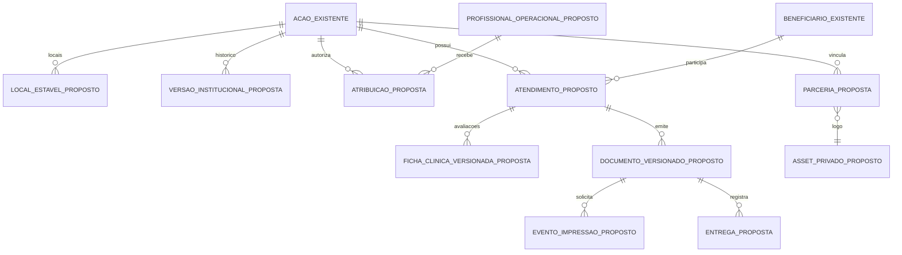

# MVP ocular — proposta, backlog e aceite após a Fase 0

Data: 30/10/2026. **Proposta não executada**, derivada da
[ficha e do código inspecionados](FASE_0_DESCOBERTA_2026-10-30.md).
O prompt inicial limita esta entrega à Fase 0. Os nomes novos abaixo são
propostas explícitas, não tabelas/rotas existentes nem migrações aplicadas.

## 1. Modelo de dados e fronteiras propostas

Preservar ações, beneficiários, participações, imports, sessão institucional,
auditoria e integração 1.1. O acréscimo clínico depende primeiro de definição de
privilégios/topologia e autorização operacional. Não adicionar glicose, sangue ou
graus ao DTO geral nem exportar o envelope de beneficiários.



| Entidade/mudança proposta | Dados e invariantes | Compatibilidade/segurança |
| --- | --- | --- |
| Versão institucional da ação | Instrumento, nome/título, número, autor, apoio, aprovação pública e versão; nenhum dado de paciente | Administração/Tecnologia edita; ausência não vira emenda fictícia. Não usar nome como chave única |
| Logos/parceria | Dois slots opcionais (governo e clínica), autorização de uso/publicação por versão, hash e tipo real de imagem | AC Social fixa do asset oficial; mesmos slots em TOTAL e PARCIAL. Limitar bytes/dimensões, reencodar imagem, impedir SVG/HTML executável e URL arbitrária; storage privado e projeção pública só aprovada |
| Local estável | UUID, ação, IBGE e nome do local; correspondência explícita do índice JSON antigo | Não reordenar vínculo existente; rollback preserva mapeamento. Município da pessoa/termo separado |
| Profissional/atribuição | Identificador de identidade já validada, papel, habilitação, ações/locais/casos atribuídos, atividade/revogação e histórico | Não copiar senha institucional. Cadastro profissional não é autenticação. CRM/UF só para médico; CPF profissional não é CPF do paciente. Login local avançado permanece futuro |
| Atendimento | UUID, ação, pessoa, local, atribuição, versão, chave idempotente de evento e estado operacional | Diferenciar de participação geral. Definir se uma ação admite várias consultas; não inferir consulta de importação ou de reimpressão |
| Ficha clínica versionada | Só campos aprovados da matriz: exames complementares e quadro ocular; dados cifrados segregados, autor/habilitação e versão da ficha | Somente profissional com permissão por ação/caso/finalidade. Sem acesso geral de recepção ou Tecnologia; sem log do conteúdo |
| Documento | Tipo geral/clínico/laboratório/etiqueta, versão imutável, atendimento, ficha e snapshot institucional, hash e storage privado | Imagem/logo e metadados da época conservados após edição administrativa. Não chamar PDF sem assinatura de receita digital assinada |
| Impressão/reimpressão | Evento com ator, versão, tipo, horário e ID de solicitação | `window.print` prova abertura do diálogo, não impressão física. Nunca aumentar atendimentos por abrir/baixar/reimprimir |
| Entrega | Atendimento, documento/versão, ator, data e confirmação física conforme fluxo aprovado | Não inferir de impressão. Corrigir por evento auditado; assinatura digital em standby |

Proposta de estados a aprovar: EM_TRIAGEM → AGUARDANDO_PROFISSIONAL →
EM_ATENDIMENTO → FICHA_CONCLUIDA; entrega/documentos têm estados próprios.
Cancelamento/revisão preservam histórico. Não introduzir AGUARDANDO_ASSINATURA
como pré-requisito do MVP nem alterar estados editoriais da ação para fingir
estados de consulta. Campos finais obrigatórios, transições e correções devem ser
validados pelo responsável clínico antes de migrations/implementação.

## 2. Contrato agregado futuro sem identificação de pacientes

O item 1.1 atual e a exportação v2 da Agenda são contratos distintos: a v2 é
envelope congelado, não uma autorização para mudar o schema dos itens 1.1.
A Agenda aceita exatamente os campos antigos e rejeita extras.

**Proposta de item 1.2, ainda não implementada/negociada:** conservar a semântica
de snapshot por ação/revisão e acrescentar apenas projeção institucional aprovada.
Exemplo exclusivamente sintético, sem PII de paciente:

```json
{
  "schema_version": "1.2",
  "event_id": "31a06d34-18de-4ff2-901e-36dd0a9dad81",
  "source": "ac-actions-map",
  "acao_id": "55f88cfb-e687-4661-b426-de496e301083",
  "revisao": 1,
  "operacao": "upsert",
  "categoria": "Saúde ocular",
  "inicio_em": null,
  "fim_em": null,
  "municipios_ibge": ["2508901"],
  "quantidade_acoes": 1,
  "quantidade_participacoes": 0,
  "quantidade_pessoas_contempladas": 0,
  "publicavel": false,
  "metadados_publicos": null
}
```

Quando houver aprovação vigente, `metadados_publicos` poderá conter somente
`titulo_acao`, `resumo_publico` e `instrumento` com `tipo`, `nome`, `numero`,
`autor`, além de parceiros públicos expressamente autorizados. Esses nomes são
propostos. Cada subobjeto exige allowlist e rejeição de extras. Sem aprovação,
enviar `null`; não usar omissão para manter uma versão pública antiga por engano.
Alterar/revogar aprovação gera nova revisão e retirada da projeção anterior.
Órgão/clínica/logo/profissional ficam desativados para divulgação por padrão.

Não incluir identificador de pessoa, nome de beneficiário, documento, contato,
saúde, assinatura, arquivo de ficha, ID de atendimento, texto clínico ou valores
financeiros privados. Autor da emenda é metadado administrativo; sua divulgação
não autoriza associação nominal de paciente ao autor. Texto livre institucional
continua exigindo revisão; allowlist de chaves não classifica automaticamente PII.

Transição proposta:

1. Aprovar campos públicos e schema com responsáveis das quatro aplicações.
2. Implementar leitor compatível na Agenda e versionamento de item/envelope;
   consumidor da Plataforma recusa versão desconhecida sem promover staging.
3. Só então habilitar emissor novo no Map; preservar caminho 1.1 enquanto houver
   consumidor antigo. Não misturar 1.1 e 1.2 sem uma regra de compatibilidade testada.
4. Exigir ACK da versão/evento esperado, outbox transacional, idempotência,
   revisão monotônica, checksum/paginação congelada e teste de retirada.
5. Plataforma aplica política pública, aprovação, supressão e validade; Portal
   consome somente sua projeção. Não criar Portal → Map nem Map → Portal.

### Semântica de indicadores

| Medida | Denominador/regra proposta |
| --- | --- |
| Ações | IDs distintos elegíveis após filtros; uma revisão corrente por ação |
| Pessoas únicas internas | IDs próprios distintos no recorte **apenas quando identidade tiver sido conciliada**; informar cobertura de conciliação. Nome/CPF documental não unifica automaticamente |
| Participações/atendimentos | Eventos distintos; participação legada não comprova consulta. Reimpressão não altera contador |
| Fichas concluídas | Atendimento com versão clínica finalizada válida, excluindo cancelados conforme regra aprovada |
| Fichas/etiquetas emitidas | Documentos distintos por tipo; separar primeira emissão, reemissão e solicitação de impressão |
| Entregas | Confirmação explícita por atendimento/documento; impressão não conta entrega |
| Por município/local | Usar local do evento quando conhecido; não replicar total da ação multilocal em todas as cidades |
| Por emenda/autor | Agrupar por instrumento estável, sem unir só pelo nome do autor; não publicar “pessoas únicas entre ações” sem regra segura de deduplicação |
| Ausências | Categoria “não informado” e cobertura; zero só quando medido. Data do upload não substitui a da ação |
| Saúde | Só medidas presentes na ficha, justificadas e aprovadas, com unidade, população elegível, denominador e ausências separados; restrito a Admin/Tech com finalidade autorizada |

Filtros combináveis previstos: ação, período, município, local, parceiro, órgão,
instrumento/número/autor. Aplicá-los no servidor antes da agregação; não baixar
cadastros clínicos para calcular no navegador. Pequenos grupos exigem política
institucional; não inventar limiar nem expor rankings até aprovação e conciliação.

## 3. Backlog priorizado com aceite

| ID | Prioridade/fase | Entrega | Aceite e dependência |
| --- | --- | --- | --- |
| P0-01 | P0 / Fase 0 | Localizar e ler a ficha e o acervo | Estrutura/rótulos do XLSX conferidos; 50 páginas renderizadas com proteção. Aprovação da versão e leitura privada da página 34 pendentes |
| P0-02 | P0 / Fase 0 | Inventário, matriz de campos/permissões e conflitos | Entregues no relatório; manter atual versus proposto separados |
| P0-03 | P0 / guarda | Retirar fonte preenchida do Git e reforçar gate | Original preservado por hash; staging e tracked rejeitam fontes; teste sintético e CI configurados. Histórico remoto exige avaliação própria |
| P0-04 | P0 / decisão clínica | Aprovar campos, unidades, necessidade e competência | Responsável nominal aprova matriz e distingue profissional/beneficiário; não coletar exames por hipótese |
| P0-05 | P0 / segurança | Definir identidade/escopo mínimo do piloto e topologia | Recepção/profissional sem acesso global; credenciais individuais; banco operacional independente definido; nenhuma liberação clínica antes disso |
| P0-06 | P0 / operação | Retenção, backups, papel, etiqueta e responsáveis | Hardware/medidas documentados, restore e fluxo físico aprovados |
| P1-01 | P1 / modelagem | Migração aditiva, locais estáveis e autorização por recurso | Preview/rollback em staging, FKs/CAS/índices/grants; sem alterar identidade institucional |
| P1-02 | P1 / ações | Emenda/convênio, apoio e três marcas | Admin/Tech edita; governo/clínica opcionais em TOTAL e PARCIAL; AC Social fixa; validação/saneamento e publicação opt-in |
| P1-03 | P1 / recepção | Atendimento com dados pessoais e herança institucional em leitura | Ação atribuída, snapshot quando emitido; sem redigitação de emenda; sem acesso clínico/analytics/tecnologia |
| P1-04 | P1 / clínica | Ficha aprovada e fila do profissional | Permissão por ação/caso/habilitação, campos fiéis, cifragem/versão/auditoria; outro profissional recebe negação |
| P1-05 | P1 / documentos | Ficha clínica/laboratório e etiqueta | Imprimir ficha, etiqueta ou ambas; IDs/versão corretos; etiqueta mínima sem grau/diagnóstico/CPF completo; sem duplicar atendimento |
| P1-06 | P1 / entrega | Confirmação/segunda via e listagem segura | Reimpressão usa documento/snapshot existente; entrega explícita; sem alterar consulta por imprimir |
| P1-07 | P1 / homologação | Acesso negado, IDOR, impressão física e rollback | Matriz negativa passa em API/BFF; ficha e etiqueta legíveis na impressora real; restore ensaiado |
| P2-01 | P2 / analytics | Filtros e medidas reconciliadas | Apenas Admin/Tech; sem nominais, nulos/cobertura e denominadores visíveis; reimpressão não aumenta atendimentos |
| P2-02 | P2 / integração | Contrato novo pelas quatro aplicações | Compatibilidade, ACK, duplicata, retirada/ordenação, paginação e zero/indisponível/suprimido distintos; E2E real em staging |
| P2-03 | P2 / histórico | Revisão/associação supervisionada de fontes | Dry-run/backup/manifesto privado; não inventar exames de fichas antigas; lote definitivo com autorização própria |
| P3-01 | P3 / standby | Contas locais exclusivas e autenticação avançada | Arquitetura separada, sem acesso às demais aplicações; somente em solicitação futura |
| P3-02 | P3 / standby | Assinatura eletrônica, gov.br, verificador público | Aprovação técnica/clínica/jurídica específica; não bloquear papel/etiqueta do MVP |
| P3-03 | P3 / opcional | Automação e analytics clínico avançado | Necessidade e privacidade comprovadas; nenhuma pressão para adiar os controles P0/P1 |

Sequência recomendada: concluir decisões P0 → modelagem/segurança em staging →
cadastro da ação → recepção/ficha → documentos/entrega → homologação. Analytics e
contrato novo avançam após medidas confiáveis; integração anterior permanece
estável. Não há estimativa de prazo operacional aprovada: data real da próxima
ação, equipe disponível e impressoras não foram confirmadas.

## 4. Plano de testes e impressão física

Os 114 testes de backend e 20 cenários de navegador executados nesta revisão
validam o fluxo atual e o novo gate de privacidade, **não os recursos propostos**.

| Cenário futuro obrigatório | Resultado esperado |
| --- | --- |
| Recepção consulta caso/ação alheia, clínica, analytics ou tecnologia | 403/404 no backend e BFF, sem conteúdo por busca/download/cache |
| Profissional consulta outro caso sem atribuição ou permissão revogada | Negação imediata, inclusive documentos já emitidos |
| Administração chama rotas de tokens/diagnóstico | 403; menu oculto não é o teste |
| Edição da emenda ou troca de logo após emissão | Documento emitido conserva snapshot/hash e identidade profissional da versão |
| Reenvio do mesmo cadastro/emissão/entrega | Um efeito lógico; conflito divergente, sem contagem duplicada |
| Upload de logo inválido/ativo/excessivo e parceiro ausente | Rejeição segura; documento funciona só com AC Social |
| Mesma ação em dois municípios e mesma pessoa em várias ações | Totais/denominadores corretos e limites de deduplicação explícitos |
| Emissor/receptor de versões distintas, ACK vazio, indisponibilidade | Sem falso entregue, sem perda de outbox, sem projeção parcial |
| Payload nominal, clínico ou extra aninhado | Rejeição sem eco/log de conteúdo |
| Pipeline até Portal | Apenas metadados aprovados/agregados; retirada e expiração respeitadas |

Roteiro **físico ainda não executado**:

1. Registrar impressora, driver, papel A4, dimensão/margem/largura imprimível da
   etiqueta, orientação e escala 100%. Confirmar impressão mista ou em dispositivos
   distintos; navegador não garante seleção automática de impressora por artefato.
2. Usar somente dados sintéticos: nomes curtos/longos, campos ausentes, ambos os
   olhos, textos máximos, só AC Social e combinações de uma/duas logos opcionais.
3. Imprimir ficha, etiqueta e ambas em TOTAL e PARCIAL; conferir corte, margens,
   contraste, legibilidade, ordem, cabeçalho, quebras e ausência de etiqueta vazia.
4. Etiqueta: verificar ID de atendimento legível, identificação mínima e vínculo
   ao pacote. Testar leitura de código somente se um código/leitor for aprovado;
   não assumir que exista. Nenhum resultado clínico/CPF completo na etiqueta.
5. Encaminhar a via física ao profissional responsável para validar quadro ocular,
   dados herdados e espaço de carimbo/assinatura; não chamar esse aceite de assinatura
   eletrônica. Revisar dado profissional diferente de dado de paciente.
6. Cancelar diálogo, reabrir, reimprimir e imprimir após correção/versionamento;
   contadores de consulta/pessoas inalterados. Registrar resultado observado e
   responsável, distinguindo solicitação de impressão e entrega.
7. Interromper rede antes/depois da emissão em teste. Atualmente a aplicação precisa
   da API para buscar ficha; **não há modo offline implementado**. Não criar cache
   clínico persistente no navegador para prometer impressão sem internet.
8. Arquivar evidência sintética de renderização/PDF local e aceite físico, sem
   foto de paciente ou impressão nominal em Git. Falha em item essencial bloqueia
   liberação até correção e repetição do cenário afetado.

## 5. Migração reversível e operação

### Situação desta entrega

Nenhum DDL/migração clínica, importação, rotação de chave, deploy ou alteração
produtiva executado. O SQLite real foi inspecionado somente por metadados em modo
leitura. Os testes usam identidades sintéticas e bancos descartáveis. A retirada
da planilha do índice preserva seu hash e a cópia local; não se reescreve o histórico.

### Roteiro futuro sujeito à fase liberada

1. Aprovar topologia, política de dados, papéis e modelo da ficha. Separar banco
   operacional e adaptador institucional; definir credenciais/read-only/EXECUTE
   sem ampliar permissões sobre a Agenda nem enfraquecer RLS.
2. Registrar versões aplicadas, contagens e checksums sem PII. Fazer backup
   consistente do banco/objetos e cópia da chave sob controles separados; restaurar
   em ambiente isolado e provar leitura dos dados antes de qualquer migração.
3. Criar migração aditiva depois de `0006_nonexpiring_tokens`, com tabelas novas,
   FKs, índices e privilégios mínimos. Não fazer DDL no startup/build nem atualizar
   automaticamente credenciais/nomes/dados históricos.
4. Migrar locais via mapa explícito `(acao_id, local_indice) → local_id`. Registrar
   conflito e bloquear vínculo ambíguo. Preservar leitura antiga durante transição;
   não alterar participação geral para inventar um atendimento clínico.
5. Executar preview e teste de dupla execução/concorrência/rollback em staging,
   usando dados sintéticos. Validar escopos, snapshot dos documentos e matriz de
   acesso antes de habilitar qualquer leitura clínica.
6. Versionar e homologar contratos pelo pipeline em ordem consumidor→emissor;
   flags novas desligadas por padrão. A virada do escritor/leitor do Portal exige
   aceite próprio, com reconciliação e sem dois escritores ativos.
7. Só com liberação específica de produção: janela, responsáveis, backup
   restaurável, revisão de grants/versões, aplicação controlada e verificação
   agregada. Não fornecer aqui um comando genérico `upgrade head` para produção.

Rollback futuro: desativar novas entradas e publicação por configuração, preservar
atendimentos/documentos/auditoria já produzidos e usar uma versão compatível com o
schema e o novo formato. Reverter código sem apagar tabelas/keys ou forçar downgrade.
Não servir dados clínicos por uma versão antiga com autorização global inadequada.
Se não houver leitor compatível, bloquear a função e usar o procedimento de
contingência aprovado; restauração de backup somente com plano de reconciliação.
Retomar consumidores sem reativar snapshots/publicações revogados.

Rollback desta correção de privacidade: fontes continuam disponíveis no disco e
por canal privado. Não reintroduzir a ficha preenchida no Git para desfazer docs
ou código. Histórico anterior pode exigir remoção coordenada com clones/remotos;
isso depende de autorização específica e não é resolvido por `git rm --cached`.

## 6. Checklist de liberação do piloto

- [x] Fonte original localizada e matriz estrutural registrada sem dados pessoais.
- [x] Inventário real de código/schema local, autenticação e contratos documentado.
- [x] Testes do fluxo atual, privacidade de fontes e preservação dos originais.
- [ ] Modelo oficial aprovado, página 34 revisada privadamente e campos/unidades/habilitações confirmados.
- [ ] Identidade mínima e autorização operacional por ação/caso implementadas e testadas.
- [ ] Topologia/grants, retenção, backups/restauração, guarda de papel e operação aprovados.
- [ ] Ação com três marcas/emenda, recepção, ficha e snapshot implementados.
- [ ] Ficha + etiqueta, segunda via e entrega implementadas e homologadas em papel.
- [ ] Indicadores essenciais reconciliados; limites de pessoas únicas explicitados.
- [ ] Integração nova homologada ou fluxo anterior mantido sem anunciar dados novos.
- [ ] Responsáveis técnicos, clínicos e institucionais registraram aceite da fase.

**Estado do novo piloto: NÃO LIBERADO.** O diagnóstico entregue é utilizável para
iniciar a próxima fase delimitada; não comprova prontidão operacional do MVP.
